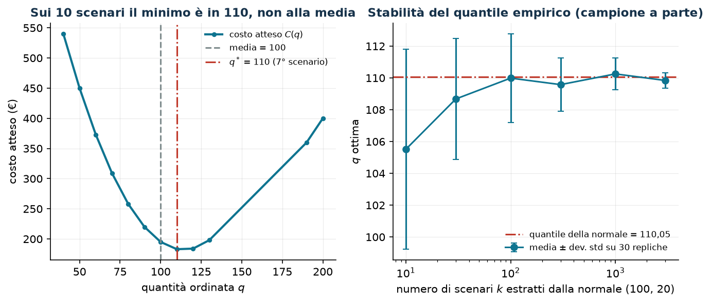
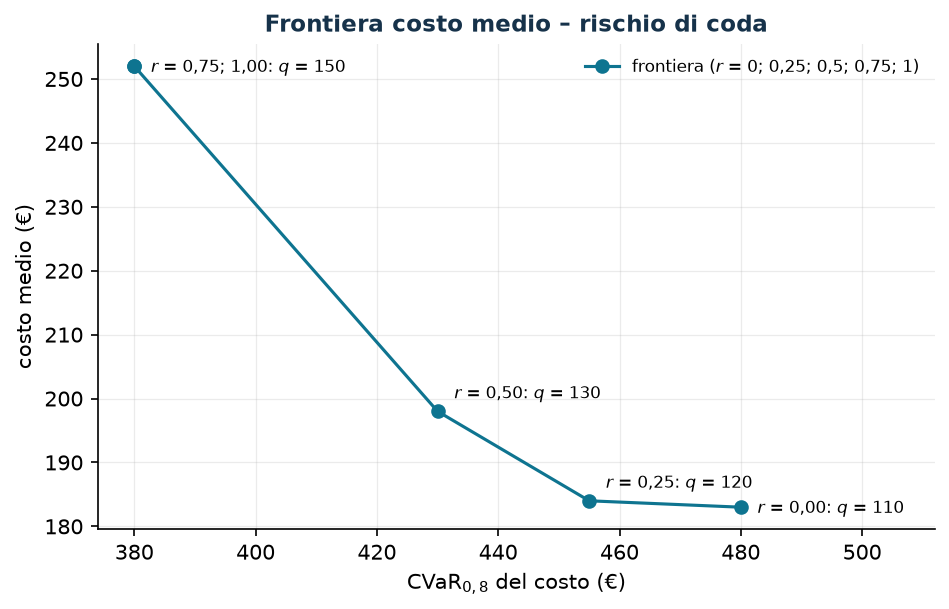

# Il Newsvendor e le sue varianti

[:material-file-pdf-box: Dispensa (PDF)](pdf/dispensa-modellazione-pl.pdf) · [:material-presentation: Slide del capitolo (PDF)](pdf/slide-08-newsvendor.pdf) · [:material-gesture-tap: App: Newsvendor: ordine ottimo sui 10 scenari](laboratorio/newsvendor-scenari.md)

**Classe:** convesso 1D / LP stocastico a scenari · **Script:** `python/lab08_newsvendor.py`

[](https://colab.research.google.com/github/fabiofurini/modellazione-pl/blob/main/notebooks/lab08_newsvendor.ipynb)

!!! nota "Prerequisiti"

    - Da questo modulo, [Capitolo 2 «Richiami: programmazione lineare e analisi di sensitività»](https://fabiofurini.github.io/modellazione-pl/teoria-lp/): i prezzi ombra e i loro intervalli di validità.

    - Da questo modulo, [Capitolo 3 «Il solver: costruire, risolvere, interpretare»](https://fabiofurini.github.io/modellazione-pl/solver-lp/): la costruzione e la soluzione di un LP in `gurobipy`.

!!! chiave "Obiettivi"

    Alla fine di questo capitolo sarai in grado di:

    - ricavare e applicare la regola del quantile;

    - trasformare un problema stocastico in un LP a scenari con il trucco della parte positiva;

    - quantificare il valore di modellare l'incertezza (VSS);

    - incorporare livelli di servizio e avversione al rischio.

Scegliere una quantità **prima** di osservare la domanda: moda e stagionali,
freschi, farmaci, capacità alberghiera. È la porta d'ingresso dell'ottimizzazione
stocastica, con un risultato netto: **la quantità ottima non è la domanda media**.

**Il problema a parole.** *Decidiamo* la sola quantità $q$. *L'obiettivo*: minimo
costo atteso dell'errore — troppo ($c_o$ per unità invenduta) o troppo poco ($c_u$
per vendita persa).

## Modello base e regola del quantile

**Dati (input del modello).**

| Simbolo | Tipo | Significato |
|---|---|---|
| $D$ | variabile aleatoria $\ge 0$ | domanda, con funzione di ripartizione $F$; eccezione alla convenzione sulle maiuscole, per aderenza alla letteratura: variabile aleatoria maiuscola, realizzazioni minuscole ($d_s$) |
| $c_u$ | $\in \mathbb{Q}_{> 0}$ | costo unitario di *underage* (domanda non servita): margine perso più eventuale penalità (€) |
| $c_o$ | $\in \mathbb{Q}_{> 0}$ | costo unitario di *overage* (unità invenduta): costo meno valore di recupero (€) |

Con prezzo di vendita $p$, costo d'acquisto $c$ e valore di recupero $v \le c$ (tutti
in $\mathbb{Q}_{>0}$): $c_u = p - c$ e $c_o = c - v$.

**Variabile decisionale.** Introduciamo una variabile non negativa:

$$
q = \text{quantità ordinata prima di osservare la domanda } D.
$$

Usando questa variabile, il modello per il problema è il seguente:

$$
\begin{aligned}
\min ~~ c_o\, \mathbb{E}\bigl[(q - D)^+\bigr] + c_u\, \mathbb{E}\bigl[(D - q)^+\bigr] & & \\
\text{soggetto a} \quad q &\ge 0. &
\end{aligned}
$$

Descrizione della funzione obiettivo e del vincolo:

- la funzione obiettivo convessa minimizza il costo atteso dell'errore: eccedenza
  $(q - D)^+$ pagata $c_o$ e carenza $(D - q)^+$ pagata $c_u$ (il simbolo
  $(x)^+ = \max\{x, 0\}$ indica la parte positiva);
- il vincolo di non negatività definisce la variabile del modello.

Se $F$ è continua, l'ottimo soddisfa la **regola del quantile**:

$$
F(\tilde q) = f = \frac{c_u}{c_u + c_o}
\qquad\Longrightarrow\qquad
\tilde q = F^{-1}(f).
$$

Ragionamento marginale: la $q$-esima unità in più rende $c_u$ se la domanda la
assorbe (probabilità $1 - F(q)$) e costa $c_o$ se resta invenduta (probabilità
$F(q)$); conviene finché $c_u\,(1 - F(q)) \ge c_o\,F(q)$, cioè finché
$F(q) \le c_u/(c_u + c_o)$.

!!! example "Esempio a mano (domanda discreta)"
    $D \in \{80, 100, 120\}$ equiprobabili, $c_u = 9$, $c_o = 4$ (quindi
    $f = 9/13 = 0{,}6923$): $C(80) = 180$, $C(100) = 86{,}7$,
    $C(120) = \mathbf{80}$. Si ordina il **massimo**: con $c_u \gg c_o$ restare corti
    costa più del doppio che restare lunghi. (Regola discreta: il più piccolo $q$ con
    $F(q) \ge 0{,}6923$, cioè $\tilde q = 120$.)

## Caso di studio

Panetteria: $p = 15$, $c = 6$, $v = 2$ € → $c_u = 9$, $c_o = 4$, quindi
$f^* = 9/13 = 0{,}6923$. La domanda di panettoni è descritta da $k = 10$ scenari
equiprobabili ($w_s = 1/10$): nove stagioni regolari, da 50 a 130 pezzi, e una
stagione eccezionale da 190 pezzi, la coda destra (dati in
`dati/newsvendor_scenari.csv`). La domanda media è 100.

| scenario $s$ | 1 | 2 | 3 | 4 | 5 | 6 | 7 | 8 | 9 | 10 |
|---|---|---|---|---|---|---|---|---|---|---|
| $d_s$ | 50 | 60 | 70 | 80 | 90 | 100 | 110 | 120 | 130 | 190 |
| $F(d_s)$ | 0,1 | 0,2 | 0,3 | 0,4 | 0,5 | 0,6 | 0,7 | 0,8 | 0,9 | 1 |
| $C(d_s)$ (€) | 450 | 373 | 309 | 258 | 220 | 195 | **183** | 184 | 198 | 360 |

La regola del quantile discreta prende il più piccolo $d_s$ con
$F(d_s) \ge 0{,}6923$: $F(100) = 0{,}6$ non basta, $F(110) = 0{,}7$ sì. Quindi
$\tilde q = 110$, il 7° scenario in ordine crescente. La riga dei costi lo conferma:
$C(q)$ è lineare a tratti, con i vertici negli scenari, e il minimo è in 110.

```text
f* = 9/13 = 0,6923
q* = il piu' piccolo d_s con F(d_s) >= 0,6923: 110 unita'   (media = 100)
costo atteso in q*: 183,00 EUR    in q = media: 195,00 EUR
```



Il grafico di sinistra è il costo atteso sui 10 scenari. Quello di destra è
un'illustrazione a parte, con un campione suo, descritta più sotto.

## La formulazione lineare a scenari

Quando $F$ non è nota in forma chiusa — il caso normale in azienda — si usano gli
scenari. Nuovi dati del modello: il numero di scenari $k \in \mathbb{Z}_{\ge 1}$,
indicizzati da $s \in \{1, 2, \dots, k\}$; per ogni scenario, la domanda
$d_s \in \mathbb{Q}_{\ge 0}$ e la probabilità $w_s \in \mathbb{Q}_{\ge 0}$, con
$\sum_{s=1}^{k} w_s = 1$. Oltre a $q$, introduciamo le seguenti $2\,k$ variabili
non negative:

$$
\begin{cases}
o_s = \text{eccedenza (unità invendute) nello scenario } s\\[1ex]
u_s = \text{carenza (domanda non servita) nello scenario } s
\end{cases}
\qquad \forall s \in \{1, 2, \dots, k\}.
$$

Usando queste variabili, un modello LP per il problema è il seguente:

$$
\begin{aligned}
\min ~~ \sum_{s=1}^{k} w_s \bigl( c_o\, o_s + c_u\, u_s \bigr) & & \\
\text{soggetto a} \quad o_s &\ge q - d_s, & \forall s \in \{1, 2, \dots, k\}, \\
u_s &\ge d_s - q, & \forall s \in \{1, 2, \dots, k\}, \\
q &\ge 0, & \\
o_s,\ u_s &\ge 0, & \forall s \in \{1, 2, \dots, k\}.
\end{aligned}
$$

Descrizione della funzione obiettivo e dei vincoli:

- la funzione obiettivo lineare è la media pesata, sugli scenari, dei costi di
  eccedenza e di carenza: la versione "a scenari" del costo atteso del modello base;
- i vincoli lineari di **eccedenza** e di **carenza** definiscono $o_s$ e $u_s$ a
  partire dall'unica vera decisione $q$; insieme alle non negatività realizzano le
  parti positive ($2\,k$ vincoli lineari);
- i vincoli su $q$, $o_s$ e $u_s$ definiscono le variabili del modello.

Il **trucco delle parti positive**: l'obiettivo schiaccia $o_s$ e $u_s$ sui valori
$\max\{q - d_s, 0\}$ e $\max\{d_s - q, 0\}$ senza variabili binarie — lo stesso
meccanismo tornerà nel CVaR e nella regressione quantile.

Con i 10 scenari del caso l'LP ha 21 variabili ($q$, 10 eccedenze e 10 carenze) e 20
vincoli, due per scenario: per lo scenario 1, $q - o_1 \le 50$ e $q + u_1 \ge 50$.
Nella funzione obiettivo ogni $o_s$ ha coefficiente $c_o/10 = 0{,}4$ e ogni $u_s$
ha $c_u/10 = 0{,}9$:

$$
\begin{array}{rrcrcrcl}
\min & & & 0{,}4 \textstyle\sum_{s=1}^{10} o_s & + & 0{,}9 \textstyle\sum_{s=1}^{10} u_s & & \\[1ex]
\text{soggetto a} & q & - & o_s & & & \le & d_s, \\
 & q & & & + & u_s & \ge & d_s, \qquad s = 1, \dots, 10, \\[1ex]
 & q, & & o_s, & & u_s & \ge & 0,
\end{array}
$$

con $d_1, \dots, d_{10} = 50, 60, 70, 80, 90, 100, 110, 120, 130, 190$. Il modello
numerico scritto riga per riga, scenario per scenario, è nell'app in fondo alla pagina.

```text
LP con k = 10 scenari (21 variabili, 20 vincoli): q = 110
quantile empirico al 69,23%: 110   (coincidono: e' un teorema)
  s     1   2   3   4   5   6   7   8   9  10
d_s    50  60  70  80  90 100 110 120 130 190
o_s    60  50  40  30  20  10   0   0   0   0
u_s     0   0   0   0   0   0   0  10  20  80
costo 240 200 160 120  80  40   0  90 180 720    media 183
VSS: decisione q = E[D] = 100 costa 195; q stocastica costa 183
     valore della soluzione stocastica = 12 EUR per ciclo
```

Il *valore della soluzione stocastica* (VSS) vale qui 12 € a ciclo, il 6,6% del
costo: è il guadagno di **modellare** l'incertezza invece di sostituirla con la
media. Il solo scenario eccezionale, con 80 pezzi di domanda non servita, pesa 72 €
sui 183 del costo atteso.

**Stabilità del quantile empirico.** Dieci scenari sono pochi, e anche gli scenari
sono un campione. Il grafico di destra lo mostra con un'illustrazione a parte: non
usa i 10 scenari del caso, ma campioni di $k$ scenari estratti da una domanda normale
di media 100 e deviazione standard 20, 30 campioni per ogni $k$.

```text
quantile teorico della normale: F^-1(0,6923) = 110,05
k =   10: q media 105,52, dev. std tra 30 repliche 6,28
k =  100: q media 109,99, dev. std tra 30 repliche 2,78
k = 3000: q media 109,84, dev. std tra 30 repliche 0,47
```

Con 10 scenari la $q$ ottima cambia di circa ±6 unità da un campione all'altro, con
100 di circa ±3, con 3000 di mezza unità: la decisione eredita la varianza degli
scenari.

## Livelli di servizio e rischio

```text
    q   P(D<=q)   fill rate   costo
  100     60%        85%      195
  110     70%        89%      183   <- ottimo economico
  120     80%        92%      184
  130     90%        94%      198   <- cycle service level 90%  (+15 EUR)
  140     90%        95%      225   <- fill rate 95%            (+42 EUR)
  190    100%       100%      360   <- cycle service level 95%  (+177 EUR)
```

!!! warning "Non confondere i livelli di servizio"
    In $\tilde q = 110$ la probabilità di evitare lo stock-out è il 70%, ma il
    *fill rate* (quota di domanda servita in media) è l'89%: misure diverse che i
    contratti spesso confondono. Promettere "95% di probabilità di copertura totale"
    obbliga a coprire lo scenario eccezionale e costa +177 € a ciclo; promettere
    "95% di fill rate" costa +42 €. Leggere bene lo SLA prima di firmarlo.

Con la formulazione lineare del CVaR minimizziamo
$(1-r)\,\mathbb{E}[\text{costo}] + r\, \mathrm{CVaR}_{0,8}(\text{costo})$. Il livello
è $\alpha = 0{,}8$: con 10 scenari equiprobabili la coda $1 - \alpha = 0{,}2$ sono
esattamente i 2 scenari più costosi, e il CVaR è la media dei loro costi. Con
$\alpha = 0{,}9$ la coda sarebbe il solo scenario peggiore.

```text
r = 0,00: q = 110  costo medio 183  CVaR80 480
r = 0,25: q = 120  costo medio 184  CVaR80 455
r = 0,50: q = 130  costo medio 198  CVaR80 430
r = 0,75: q = 150  costo medio 252  CVaR80 380
r = 1,00: q = 150  costo medio 252  CVaR80 380
soglie: q passa a 120 per r > 1/26 = 0,038, a 130 per r > 14/39 = 0,359,
        a 150 per r > 54/104 = 0,519
```



In $q = 110$ i due scenari più costosi sono quello eccezionale (720 €, 80 vendite
perse) e quello da 50 pezzi (240 €, 60 invenduti): CVaR $= (720 + 240)/2 = 480$ €.
Il decisore avverso al rischio ordina di più. Il primo passo, da 110 a 120, costa 1 €
in media e taglia il CVaR di 25 €. L'ultimo, da 130 a 150, costa 54 € per 50 € di
CVaR: i primi passi danno molta protezione per poco costo medio,
l'ultimo poca protezione per molto costo.

Con $r = 1$ l'ordine si ferma a 150: lì lo scenario da 60 pezzi (90 invenduti, 360 €)
costa quanto lo scenario eccezionale (40 vendite perse, 360 €). Ordinare ancora di più
alzerebbe il costo degli invenduti nella coda.

## Multiprodotto con budget condiviso

Tre dolci sugli stessi 10 scenari, con un budget di produzione di 1250 €. Le
domande sono legate fra loro: le stagioni buone e cattive lo sono per tutti e tre.

| dolce | $c$ (€) | $c_u$ | $c_o$ | domande $d_s$ negli scenari 1–10 |
|---|---|---|---|---|
| panettone | 6 | 9 | 4 | 50 60 70 80 90 100 110 120 130 190 |
| pandoro | 5 | 7 | 3,5 | 40 40 50 60 70 80 90 90 100 150 |
| torrone | 4 | 5 | 2,5 | 30 40 40 50 50 60 70 70 80 110 |

```text
  prodotto  | q senza budget | q con budget
 panettone  |          110,0 |       101,67
 pandoro    |           90,0 |        80,00
 torrone    |           70,0 |        60,00
Spesa senza budget 1390 EUR; con il budget 1250/1250
costo atteso 386,50 EUR   prezzo ombra del budget: -0,200
```

Il budget vincolante comprime le tre quantità sotto i rispettivi quantili ottimi, ma
non proporzionalmente: il pandoro perde l'11%, il torrone il 14%, il panettone l'8%.
Il duale dice che un euro di budget in più ridurrebbe il costo atteso di 0,20 €. Il
conto si fa a mano: l'euro va al panettone, che ha $q$ fra 100 e 110 ($F = 0{,}6$);
lì un pezzo in più fa risparmiare $9 \cdot 0{,}4 - 4 \cdot 0{,}6 = 1{,}2$ € e costa
6 €, cioè $1{,}2/6 = 0{,}20$ € per euro.

Il costo atteso di ogni dolce dipende solo dalle sue domande: legate o no fra loro, le
quantità ottime non cambiano. Il legame conta per il rischio: nelle stagioni cattive
i tre dolci perdono insieme.


## In sintesi

!!! chiave "In sintesi"

    - La quantità si sceglie prima di osservare la domanda, e l'ottimo è il quantile $q^* = F^{-1}\bigl(c_u/(c_u+c_o)\bigr)$, non la media.

    - Con $k$ scenari il newsvendor diventa un LP con $2k+1$ variabili: le parti positive si linearizzano senza variabili binarie.

    - Il VSS misura il guadagno di modellare l'incertezza; le decisioni stimate da pochi scenari sono instabili.

    - Livello di servizio di ciclo e fill rate sono misure diverse; con il mean-CVaR un po' di avversione al rischio dà molta protezione.

## Codice

Lo script completo del capitolo — dati, modello, soluzione, sensitività e figure —
è [`python/lab08_newsvendor.py`](https://github.com/fabiofurini/modellazione-pl/blob/main/python/lab08_newsvendor.py)
(riproducibile con `python3 python/lab08_newsvendor.py` dalla cartella `python/`).

Lo stesso codice è disponibile come notebook — [`notebooks/lab08_newsvendor.ipynb`](https://github.com/fabiofurini/modellazione-pl/blob/main/notebooks/lab08_newsvendor.ipynb) — che si apre in Colab dal badge in cima alla pagina e gira nel browser, senza installare niente.

??? example "Mostra lo script completo — `lab08_newsvendor.py`"

    ```python
    """Capitolo 8 — Il Newsvendor e le sue varianti (LP stocastico a scenari).

    Caso di studio: panetteria che decide quanti panettoni artigianali produrre.
    Prezzo p = 15 €, costo c = 6 €, recupero v = 2 € → Cu = 9, Co = 4.
    Domanda: 10 scenari equiprobabili, nove regolari da 50 a 130 e uno eccezionale da 190.

    Contenuto:
      1. Regola del quantile sugli scenari: f* = 9/13 = 0,6923 → q* = 110 (7° scenario)
      2. LP a scenari: coincide con il quantile empirico
      3. Valore della soluzione stocastica (VSS); stabilità del quantile empirico
         (illustrazione a parte, con campioni più grandi da una normale)
      4. Livelli di servizio (cycle service level, fill rate)
      5. Avversione al rischio: frontiera costo medio - CVaR_0,8 (i 2 scenari peggiori)
      6. Multiprodotto con budget condiviso
    """
    import gurobipy as gp
    import numpy as np
    import pandas as pd
    from gurobipy import GRB
    from scipy import stats

    from stile import (ARANCIO, GRIGIO, ROSSO, TEAL, intestazione, plt, salva_dat,
                       salva_dati, salva_figura)

    p, c, v = 15.0, 6.0, 2.0
    Cu, Co = p - c, c - v                 # 9 e 4

    # ----------------------------------------------------------------------
    # 1. DATI E REGOLA DEL QUANTILE SUGLI SCENARI
    # ----------------------------------------------------------------------
    intestazione("Regola del quantile sui 10 scenari")
    # nove stagioni regolari (da 50 a 130) e una eccezionale (190): la coda destra
    dom = np.array([50, 60, 70, 80, 90, 100, 110, 120, 130, 190], dtype=float)
    S = len(dom)                          # scenari equiprobabili, w_s = 1/S
    salva_dati(pd.DataFrame({"scenario": range(1, S + 1), "domanda": dom}), "newsvendor_scenari")


    def costo_atteso(q, d=dom):
        """Costo atteso sugli scenari equiprobabili: media di Co(q-d)^+ + Cu(d-q)^+."""
        return float(np.mean(Co * np.maximum(q - d, 0) + Cu * np.maximum(d - q, 0)))


    def quantile_empirico(d, f):
        """Il più piccolo valore d_s con F(d_s) >= f (regola del quantile discreta)."""
        ordinati = np.sort(d)
        return ordinati[int(np.ceil(f * len(d) - 1e-9)) - 1]


    f_star = Cu / (Cu + Co)
    q_star = quantile_empirico(dom, f_star)
    print(f"Frattile critico f* = Cu/(Cu+Co) = {Cu:.0f}/{Cu + Co:.0f} = {f_star:.4f}")
    print(f"{'d_s':>5} {'F(d_s)':>7} {'C(d_s)':>8}")
    for k, d in enumerate(np.sort(dom), start=1):
        print(f"{d:5.0f} {k / S:7.1f} {costo_atteso(d):8.1f}" + ("   <- q*" if d == q_star else ""))
    print(f"q* = il più piccolo d_s con F(d_s) >= {f_star:.4f}: {q_star:.0f} unità "
          f"(media = {dom.mean():.0f}, costo in q = media: {costo_atteso(dom.mean()):.1f} €)")

    # il costo atteso è lineare a tratti con i vertici negli scenari: bastano i vertici
    qq = np.concatenate([[40.0], np.sort(dom), [200.0]])
    salva_dat(pd.DataFrame({"q": qq, "costo": [costo_atteso(q) for q in qq]}), "cap08_costo")

    # ----------------------------------------------------------------------
    # 2. LP A SCENARI
    # ----------------------------------------------------------------------
    intestazione(f"LP a scenari (k = {S}: {1 + 2 * S} variabili, {2 * S} vincoli)")


    def newsvendor_lp(dom_s, prob=None, lam=0.0, alpha_cvar=0.80):
        """LP: min (1-lam)·costo atteso + lam·CVaR_alpha(costo). lam=0 → risk neutral."""
        Sn = len(dom_s)
        pi = np.full(Sn, 1 / Sn) if prob is None else prob
        m = gp.Model("newsvendor")
        m.Params.OutputFlag = 0
        q = m.addVar(name="q")
        o = m.addVars(Sn, name="o")                 # eccedenza
        u = m.addVars(Sn, name="u")                 # carenza
        m.addConstrs((o[s] >= q - dom_s[s] for s in range(Sn)), name="ecc")
        m.addConstrs((u[s] >= dom_s[s] - q for s in range(Sn)), name="car")
        costo_s = {s: Co * o[s] + Cu * u[s] for s in range(Sn)}
        atteso = gp.quicksum(pi[s] * costo_s[s] for s in range(Sn))
        if lam > 0:
            eta = m.addVar(lb=-GRB.INFINITY, name="eta")
            xi = m.addVars(Sn, name="xi")
            m.addConstrs((xi[s] >= costo_s[s] - eta for s in range(Sn)), name="cvar")
            cvar = eta + gp.quicksum(pi[s] * xi[s] for s in range(Sn)) / (1 - alpha_cvar)
            m.setObjective((1 - lam) * atteso + lam * cvar, GRB.MINIMIZE)
        else:
            m.setObjective(atteso, GRB.MINIMIZE)
        m.optimize()
        assert m.Status == GRB.OPTIMAL
        costi = np.array([Co * max(q.X - d, 0) + Cu * max(d - q.X, 0) for d in dom_s])
        return q.X, float(costi @ pi), costi


    q_lp, costo_lp, costi_s = newsvendor_lp(dom)
    print(f"q ottima dell'LP: {q_lp:.2f}  |  quantile empirico al {f_star:.2%}: {q_star:.2f}")
    print(f"Costo atteso: {costo_lp:.2f} €")
    print(f"{'s':>3} {'d_s':>5} {'o_s':>5} {'u_s':>5} {'costo':>6}")
    for s in range(S):
        print(f"{s + 1:3d} {dom[s]:5.0f} {max(q_lp - dom[s], 0):5.0f} {max(dom[s] - q_lp, 0):5.0f} {costi_s[s]:6.0f}")

    # ----------------------------------------------------------------------
    # 3. VSS E STABILITÀ
    # ----------------------------------------------------------------------
    intestazione("Valore della soluzione stocastica (VSS)")
    costo_det = costo_atteso(dom.mean())
    print(f"Decisione 'ingenua' q = E[D] = {dom.mean():.0f}: costo atteso {costo_det:.2f} €")
    print(f"Decisione stocastica q = {q_lp:.0f}      : costo atteso {costo_lp:.2f} €")
    print(f"VSS = {costo_det - costo_lp:.2f} € per ciclo di vendita "
          f"({(costo_det - costo_lp) / costo_lp:.1%} del costo)")

    # Illustrazione a parte, con un campione suo e più grande dei 10 scenari: se gli scenari
    # sono estratti da una domanda normale di media 100 e deviazione standard 20, quanto
    # cambia il quantile empirico (cioè la q dell'LP) da un campione all'altro?
    intestazione("Stabilità: quantile empirico di k scenari estratti da una normale (100, 20)")
    rng = np.random.default_rng(42)
    mu_d, sigma_d = 100.0, 20.0
    q_teorico = stats.norm.ppf(f_star, mu_d, sigma_d)
    print(f"quantile teorico della normale: F^-1({f_star:.4f}) = {q_teorico:.2f}")
    righe = []
    for Sn in [10, 30, 100, 300, 1000, 3000]:
        stime = [quantile_empirico(np.maximum(rng.normal(mu_d, sigma_d, Sn), 0), f_star)
                 for rep in range(30)]
        righe.append((Sn, np.mean(stime), np.std(stime)))
        print(f"  k = {Sn:5d}: q media {np.mean(stime):7.2f}, dev. std tra 30 repliche {np.std(stime):5.2f}")
    stab = pd.DataFrame(righe, columns=["S", "q_media", "q_std"])
    salva_dat(stab, "cap08_stabilita")

    # ----------------------------------------------------------------------
    # 4. LIVELLI DI SERVIZIO
    # ----------------------------------------------------------------------
    intestazione("Livelli di servizio")


    def carenza_attesa(q, d=dom):
        return float(np.mean(np.maximum(d - q, 0)))


    print(f"{'q':>5} {'P(D<=q)':>8} {'fill rate':>10} {'costo':>7}")
    for q in [100, 110, 120, 130, 140, 190]:
        print(f"{q:5.0f} {np.mean(dom <= q):8.0%} {1 - carenza_attesa(q) / dom.mean():10.0%} "
              f"{costo_atteso(q):7.1f}")
    for beta in [0.90, 0.95]:
        q_sl = quantile_empirico(dom, beta)
        print(f"  cycle service level {beta:.0%}: q = {q_sl:5.0f} "
              f"(costo +{costo_atteso(q_sl) - costo_lp:6.2f} € rispetto all'ottimo economico)")
    # fill rate 95%: la carenza attesa, lineare a tratti e decrescente in q, deve scendere a 0,05·E[D]
    vertici = np.sort(dom)
    car = np.array([carenza_attesa(q) for q in vertici])
    q_fr = float(np.interp(0.05 * dom.mean(), car[::-1], vertici[::-1]))
    print(f"  fill rate 95%           : q = {q_fr:5.0f} (costo +{costo_atteso(q_fr) - costo_lp:6.2f} €)")
    print(f"  in q* = {q_star:.0f}: fill rate {1 - carenza_attesa(q_star) / dom.mean():.0%}, "
          f"probabilità di non andare in rottura {np.mean(dom <= q_star):.0%}")

    # ----------------------------------------------------------------------
    # 5. AVVERSIONE AL RISCHIO: frontiera costo-CVaR
    # ----------------------------------------------------------------------
    alpha_cv = 0.80               # con 10 scenari la coda 1 - alpha = 0,2 sono i 2 scenari più costosi
    intestazione(f"Frontiera costo medio - CVaR (alpha = {alpha_cv:.2f}: i {round((1 - alpha_cv) * S)} "
                 f"scenari peggiori su {S})")


    def var_cvar(costi, alpha):
        """VaR_alpha e CVaR_alpha esatto di k scenari equiprobabili.

        VaR = quantile alpha (il (ceil(alpha*k))-esimo costo in ordine crescente);
        CVaR = VaR + 1/((1-alpha) k) * sum_s max(c_s - VaR, 0), il valore della formula di
        Rockafellar-Uryasev: la media esatta dei (1-alpha) k scenari più costosi.
        """
        ordinati = np.sort(costi)
        k = len(ordinati)
        var_ = ordinati[int(np.ceil(alpha * k - 1e-9)) - 1]
        return var_, var_ + np.maximum(ordinati - var_, 0).sum() / ((1 - alpha) * k)


    front = []
    for lam in [0, 0.25, 0.5, 0.75, 1.0]:
        q_l, cm, costi_l = newsvendor_lp(dom, lam=lam, alpha_cvar=alpha_cv)
        _, cvar_l = var_cvar(costi_l, alpha_cv)
        front.append((lam, q_l, cm, cvar_l))
        print(f"  r = {lam:4.2f}: q = {q_l:6.1f}, costo medio = {cm:6.2f}, "
              f"CVaR80 = {cvar_l:6.2f}")
    front = pd.DataFrame(front, columns=["lam", "q", "costo_medio", "cvar"])
    salva_dat(front, "cap08_frontiera_cvar")

    # i salti di q*: l'ottimo è un vertice della frontiera e passa al successivo quando
    # (1-r)·costo medio + r·CVaR diventa uguale nei due vertici
    vertici_f = front.drop_duplicates("q").reset_index(drop=True)
    print("Soglie di r in cui q* cambia:")
    for a, b in zip(vertici_f.itertuples(), vertici_f.iloc[1:].itertuples()):
        dE, dC = b.costo_medio - a.costo_medio, a.cvar - b.cvar
        print(f"  da q = {a.q:.0f} a q = {b.q:.0f} per r > {dE:.0f}/({dE:.0f} + {dC:.0f}) = {dE / (dE + dC):.3f}")
    print("Aumentando r si ordina di più: costa in media, protegge dagli scenari peggiori.")

    # ----------------------------------------------------------------------
    # 6. MULTIPRODOTTO CON BUDGET CONDIVISO
    # ----------------------------------------------------------------------
    intestazione("Multiprodotto: 3 dolci sugli stessi 10 scenari, budget di produzione 1250 €")
    nomi_p = ["panettone", "pandoro", "torrone"]
    # domande negli stessi scenari: le stagioni buone e cattive lo sono per tutti e tre i dolci
    dom_m = np.array([dom,
                      [40, 40, 50, 60, 70, 80, 90, 90, 100, 150],
                      [30, 40, 40, 50, 50, 60, 70, 70, 80, 110]], dtype=float)
    costi_c = np.array([6.0, 5.0, 4.0])
    Cu_m = np.array([9.0, 7.0, 5.0])
    Co_m = np.array([4.0, 3.5, 2.5])
    budget = 1250.0
    P3 = range(3)

    mm = gp.Model("newsvendor_multi")
    mm.Params.OutputFlag = 0
    qm = mm.addVars(3, name="q")
    om = mm.addVars(3, S, name="o")
    um = mm.addVars(3, S, name="u")
    mm.addConstrs((om[i, s] >= qm[i] - dom_m[i, s] for i in P3 for s in range(S)))
    mm.addConstrs((um[i, s] >= dom_m[i, s] - qm[i] for i in P3 for s in range(S)))
    v_bud = mm.addConstr(gp.quicksum(costi_c[i] * qm[i] for i in P3) <= budget, name="budget")
    mm.setObjective(gp.quicksum((Co_m[i] * om[i, s] + Cu_m[i] * um[i, s]) / S
                                for i in P3 for s in range(S)), GRB.MINIMIZE)
    mm.optimize()
    assert mm.Status == GRB.OPTIMAL
    print(f"{'prodotto':>10} | {'q senza budget':>14} | {'q con budget':>12}")
    q_solo = [quantile_empirico(dom_m[i], Cu_m[i] / (Cu_m[i] + Co_m[i])) for i in P3]
    for i in P3:
        print(f"{nomi_p[i]:>10} | {q_solo[i]:14.1f} | {qm[i].X:12.2f}")
    spesa = sum(costi_c[i] * qm[i].X for i in P3)
    print(f"Spesa senza budget: {costi_c @ np.array(q_solo):.0f} €  |  con il budget: {spesa:.2f} / {budget:.0f} €")
    print(f"Costo atteso: {mm.ObjVal:.2f} €  |  prezzo ombra del budget: {v_bud.Pi:.4f} "
          f"(riduzione del costo atteso per 1 € di budget in più)")

    # ----------------------------------------------------------------------
    # 7. FIGURE
    # ----------------------------------------------------------------------
    fig, (ax1, ax2) = plt.subplots(1, 2, figsize=(10.5, 4.0))
    ax1.plot(qq, [costo_atteso(q) for q in qq], color=TEAL, lw=2, marker="o", ms=3.5,
             label="costo atteso $C(q)$")
    ax1.axvline(dom.mean(), color=GRIGIO, ls="--", label=f"media = {dom.mean():.0f}")
    ax1.axvline(q_star, color=ROSSO, ls="-.", label=f"$q^*$ = {q_star:.0f} (7° scenario)")
    ax1.set_xlabel("quantità ordinata $q$"); ax1.set_ylabel("costo atteso (€)")
    ax1.set_title("Sui 10 scenari il minimo è in 110, non alla media")
    ax1.legend(fontsize=8, loc="upper right")
    ax2.errorbar(stab["S"], stab["q_media"], yerr=stab["q_std"], fmt="-o", color=TEAL,
                 capsize=3, label="media ± dev. std su 30 repliche")
    ax2.axhline(q_teorico, color=ROSSO, ls="-.", label=f"quantile della normale = {q_teorico:.2f}".replace(".", ","))
    ax2.set_xscale("log")
    ax2.set_xlabel("numero di scenari $k$ estratti dalla normale (100, 20)"); ax2.set_ylabel("$q$ ottima")
    ax2.set_title("Stabilità del quantile empirico (campione a parte)")
    ax2.legend(fontsize=8)
    salva_figura(fig, "cap08_quantile_stabilita")

    fig, ax = plt.subplots()
    # come l'app del laboratorio: stessa curva, stesse etichette, legenda nell'angolo vuoto in alto a destra
    pesi = "; ".join(f"{w:g}".replace(".", ",") for w in front["lam"])
    ax.plot(front["cvar"], front["costo_medio"], "-o", color=TEAL, label=f"frontiera ($r$ = {pesi})")
    # i pesi con lo stesso ordine (stesso punto) in un'unica etichetta
    # (le etichette dei punti intermedi sopra la spezzata, le altre a destra del punto)
    gruppi = list(front.groupby("q", sort=False))
    for k, (qv, g) in enumerate(gruppi):
        pesi_g = "; ".join(f"{w:.2f}".replace(".", ",") for w in g["lam"])
        ax.annotate(f"$r$ = {pesi_g}: $q$ = {qv:.0f}", (g["cvar"].iloc[0], g["costo_medio"].iloc[0]),
                    textcoords="offset points", xytext=(8, -3 if k in (0, len(gruppi) - 1) else 6), fontsize=8)
    dx = front["cvar"].max() - front["cvar"].min()
    ax.set_xlim(front["cvar"].min() - 0.06 * dx, front["cvar"].max() + 0.32 * dx)
    ax.set_xlabel("CVaR$_{0,8}$ del costo (€)"); ax.set_ylabel("costo medio (€)")
    ax.set_title("Frontiera costo medio – rischio di coda")
    ax.legend(fontsize=8, loc="upper right")
    salva_figura(fig, "cap08_frontiera")

    print("\nFatto: capitolo 8.")
    ```

## Esercizi

1. Penalità $b = 3$ € per cliente non servito ($c_u = 12$): $f^* = 0{,}75$, $\tilde q = 120$ (8° scenario).
2. Scenari da 24 osservazioni storiche vs distribuzione stimata: quale consigliare?
3. Deperibili ($v = -1$, quindi $c_o = 7$): $f^* = 0{,}5625$, $\tilde q = 100$ (6° scenario).
4. EVPI: quanto vale al massimo una previsione perfetta? (183 €/ciclo.)
5. Vincolo di fill rate al 98% vs cycle service level al 98%: confrontare quantità e costi.
6. Multiprodotto: rimettere le domande del torrone negli scenari in ordine inverso. Cambiano le quantità ottime? E il costo totale dei 2 scenari peggiori?

<!-- laboratorio-interattivo: sezione generata da genera_laboratorio.py -->

## Laboratorio interattivo { #laboratorio-interattivo }

L'app di questo capitolo risolve il modello nel browser, con i dati del caso di studio. ▶ accanto a un cursore lo fa muovere da solo.
Si apre anche a tutta pagina nel [laboratorio interattivo](laboratorio/index.md): [Newsvendor: ordine ottimo sui 10 scenari](laboratorio/newsvendor-scenari.md).

<div class="gi gi-capitolo" data-grafico="pl-newsvendor"></div>
