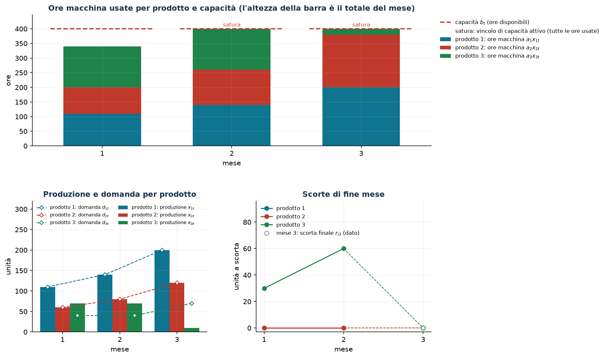

# Produzione e scorte multiperiodali

[:material-file-pdf-box: Dispensa (PDF)](pdf/dispensa-modellazione-pl.pdf) · [:material-presentation: Slide del capitolo (PDF)](pdf/slide-05-produzione.pdf) · [:material-gesture-tap: App: Piano di produzione e prezzi ombra](laboratorio/piano-produzione.md)

**Classe:** LP · **Script:** `python/lab05_produzione.py`

[](https://colab.research.google.com/github/fabiofurini/modellazione-pl/blob/main/notebooks/lab05_produzione.ipynb)

!!! nota "Prerequisiti"

    - Da questo modulo, [Capitolo 2 «Richiami: programmazione lineare e analisi di sensitività»](https://fabiofurini.github.io/modellazione-pl/teoria-lp/): i prezzi ombra, i loro intervalli di validità e il protocollo di sensitività.

    - Da questo modulo, [Capitolo 4 «Tecniche di modellazione»](https://fabiofurini.github.io/modellazione-pl/tecniche/): il bilancio delle scorte della pianificazione su più periodi.

    - Da questo modulo, [Capitolo 3 «Il solver: costruire, risolvere, interpretare»](https://fabiofurini.github.io/modellazione-pl/solver-lp/): la costruzione di un LP in `gurobipy` e la lettura di `Pi` e `SARHS`.

!!! chiave "Obiettivi"

    Alla fine di questo capitolo sarai in grado di:

    - formulare un LP multiperiodale con vincoli di bilancio delle scorte;

    - leggere e verificare i prezzi ombra della capacità e i loro intervalli di validità;

    - costruire la curva del valore della capacità;

    - spiegare come le scorte spostano capacità dai mesi scarichi ai mesi di picco.

Un'azienda decide quanto produrre oggi e quanto conservare a scorta per la domanda
futura. Produrre in anticipo costa giacenza; produrre all'ultimo momento rischia di
sbattere contro il limite di capacità proprio nei mesi di picco.

**Il problema a parole.** *Decidiamo* quante unità di ogni prodotto produrre in ogni
mese e quante tenerne a scorta. *L'obiettivo* è minimizzare produzione + giacenza.
*I vincoli*: bilancio di magazzino mese per mese (con domanda servita per intero) e
ore macchina disponibili.

## Modello

**Dati (input del modello).**

| Simbolo | Tipo | Significato |
|---|---|---|
| $n$ | $\in \mathbb{Z}_{\ge 1}$ | numero di prodotti; i prodotti sono indicizzati da $i \in \{1, 2, \dots, n\}$ |
| $m$ | $\in \mathbb{Z}_{\ge 1}$ | numero di mesi dell'orizzonte; i mesi sono indicizzati da $t \in \{1, 2, \dots, m\}$ |
| $d_{it}$ | $\in \mathbb{Q}_{\ge 0}$ | domanda del prodotto $i$ nel mese $t$ (unità) |
| $c_{it}$ | $\in \mathbb{Q}_{> 0}$ | costo di produzione di un'unità di $i$ nel mese $t$ (€) |
| $h_{it}$ | $\in \mathbb{Q}_{> 0}$ | costo di giacenza di un'unità di $i$ per il mese $t$ (€) |
| $a_i$ | $\in \mathbb{Q}_{> 0}$ | ore macchina per produrre un'unità del prodotto $i$ |
| $b_t$ | $\in \mathbb{Q}_{\ge 0}$ | ore macchina disponibili nel mese $t$ |
| $r_i$ | $\in \mathbb{Q}_{\ge 0}$ | scorta iniziale del prodotto $i$ (unità) |

**Variabili decisionali.** Introduciamo le seguenti $2\,n\,m$ variabili non negative:

$$
\begin{cases}
x_{it} = \text{unità del prodotto } i \text{ prodotte nel mese } t\\[1ex]
s_{it} = \text{unità del prodotto } i \text{ a scorta alla fine del mese } t
\end{cases}
\qquad \forall i \in \{1, 2, \dots, n\},~\forall t \in \{1, 2, \dots, m\}.
$$

!!! nota "Quantità continue"

    Un'unità di prodotto può essere un litro, un chilogrammo o un'altra unità di misura, ed è ovviamente frazionaria: le variabili $x_{it}$ e $s_{it}$ sono continue, non intere. Non possono rappresentare oggetti da contare, come il numero di automobili prodotte: servirebbero variabili intere e un modello di [programmazione lineare intera](https://fabiofurini.github.io/modellazione-mip/).

Usando queste variabili, un modello LP per il problema è il seguente:

$$
\begin{aligned}
\min ~~ \sum_{i=1}^{n} \sum_{t=1}^{m} \bigl( c_{it}\, x_{it} + h_{it}\, s_{it} \bigr) & & \\
\text{soggetto a} \quad x_{i1} - s_{i1} &= d_{i1} - r_i, & \forall i \in \{1, 2, \dots, n\}, \\
x_{it} + s_{i,t-1} - s_{it} &= d_{it}, & \forall i \in \{1, 2, \dots, n\},~\forall t \in \{2, 3, \dots, m\}, \\
\sum_{i=1}^{n} a_i\, x_{it} &\le b_t, & \forall t \in \{1, 2, \dots, m\}, \\
x_{it} &\ge 0, & \forall i \in \{1, 2, \dots, n\},~\forall t \in \{1, 2, \dots, m\}, \\
s_{it} &\ge 0, & \forall i \in \{1, 2, \dots, n\},~\forall t \in \{1, 2, \dots, m\}.
\end{aligned}
$$

Descrizione della funzione obiettivo e dei vincoli:

- la funzione obiettivo lineare minimizza il costo totale del piano, somma dei costi
  di produzione $c_{it}\, x_{it}$ e di giacenza $h_{it}\, s_{it}$ su tutti i prodotti
  e i mesi;
- i vincoli lineari di **bilancio** delle scorte sono quelli della tecnica
  [4.5 Pianificazione su più periodi](tecniche-05.md), uno per prodotto e mese; per
  $t = 1$ la scorta iniziale $r_i$ è un dato e passa a destra, nel termine noto
  ($n\,m$ vincoli lineari);
- i vincoli lineari di **capacità** assicurano che, in ogni mese, le ore macchina
  usate da tutti i prodotti non superino quelle disponibili ($m$ vincoli lineari);
- i vincoli di non negatività su $x_{it}$ e $s_{it}$ definiscono le variabili del
  modello.

Il bilancio è la contabilità di magazzino e lega i mesi tra loro; la capacità
è la risorsa scarsa condivisa, e il suo prezzo ombra dirà quanto vale un'ora in più.

!!! example "Esempio a mano (1 prodotto, 2 mesi)"
    $d = (60, 100)$, capacità $80$/mese, $c = 10$, $h = 1$. L'unico piano ammissibile
    è $x = (80, 80)$ con $s_1 = 20$: costo $1620$ €. Con un'ora in più nel mese 2 il
    costo scende di 1 € (un'unità evita un mese di giacenza): il duale del mese 2 è
    $-1$; quello del mese 1 è $0$.

## Caso di studio

Tre prodotti × tre mesi ($n = m = 3$: 18 variabili, 9 bilanci e 3 vincoli di
capacità), domanda crescente con il picco nel mese 3, 400 ore macchina al mese,
scorte iniziali nulle (dati in `dati/produzione_domanda.csv` e
`dati/produzione_capacita.csv`).

| Prodotto | $c_i$ (€/unità) | $h_i$ (€/unità/mese) | $a_i$ (ore/unità) | $r_i$ (unità) |
|---|---|---|---|---|
| 1 | 10 | 1 | 1 | 0 |
| 2 | 15 | 1,2 | 1,5 | 0 |
| 3 | 20 | 1,2 | 2 | 0 |

| mese $t$ | 1 | 2 | 3 |
|---|---|---|---|
| $b_t$ (ore) | 400 | 400 | 400 |
| $d_{1t}$ | 110 | 140 | 200 |
| $d_{2t}$ | 60 | 80 | 120 |
| $d_{3t}$ | 40 | 40 | 70 |

Per servire ogni mese con la sola produzione del mese servirebbero 280, 340 e 520
ore: al mese 3 mancano 120 ore, i mesi 1 e 2 ne lasciano libere 120 e 60.

```text
Costo totale ottimo: 11.508,00 EUR
mese        1      2      3
prod.1  110.0  140.0  200.0
prod.2   60.0   80.0  120.0
prod.3   70.0   70.0   10.0     (scorte del prodotto 3: 30 e 60 unità a fine mese 1 e 2)
```



In alto le ore macchina $a_i\, x_{it}$ usate da ogni prodotto, impilate, con la capacità $b_t$
tratteggiata: i mesi 2 e 3 sono saturi, il mese 1 usa 340 delle sue 400 ore. In basso a sinistra
la produzione $x_{it}$ (barre) e la domanda $d_{it}$ (tratteggio) di ogni prodotto; a destra le scorte $s_{it}$.

Il solver scopre da solo il **pre-build**: il prodotto 3 (2 ore/unità) viene
prodotto in anticipo, 30 unità nel mese 1 e 30 nel mese 2, per liberare 120 ore nel
mese di picco; le scorte tornano a zero nel mese finale. Conviene proprio il prodotto 3
perché anticipare un'ora macchina costa $h_i/a_i$ al mese: $1$, $0{,}8$ e $0{,}6$ € per
i prodotti 1, 2 e 3.

## Sensitività

```text
mese 1: uso 340.0/400  | Pi =  0.000 EUR/ora | valido per b_t in [340.0, +inf]
mese 2: uso 400.0/400  | Pi = -0.600 EUR/ora | valido per b_t in [340.0, 460.0]
mese 3: uso 400.0/400  | Pi = -1.200 EUR/ora | valido per b_t in [380.0, 460.0]

Verifica: +1 ora nel mese 3 -> costo da 11508.00 a 11506.80 (delta -1.200)
```

I duali crescono di $0{,}6 = h_3/a_3$ al mese: un'ora in più nel mese $t$ permette
di produrre $1/a_3$ unità del prodotto 3 *un mese più tardi*, risparmiando un mese di
giacenza. Il duale del mese 3 vale $2 \times 0{,}6 = 1{,}2$: un'ora lì evita due mesi
di giacenza a mezza unità prodotta nel mese 1. La curva del valore della capacità è
convessa e decrescente; sotto il 95% della capacità attuale (1140 ore richieste su
1200) il problema diventa **inammissibile**.

!!! tip "Take-away manageriale"
    Conviene comprare ore straordinarie nel mese 3 fino a 1,2 €/ora sotto il prezzo
    interno, e nel mese 2 fino a 0,6 €/ora; sotto il 95% della capacità il servizio
    completo non è garantibile.

Un piano *regolare*, che penalizza le variazioni della produzione da un mese
all'altro, richiede un termine quadratico nell'obiettivo e non è più un LP: è la
variante quadratica di questo modello, nel modulo *Modellazione PNL*, pagina
[«Produzione con smoothing quadratico»](https://fabiofurini.github.io/modellazione-pnl/produzione-quadratica/).


## In sintesi

!!! chiave "In sintesi"

    - Il bilancio delle scorte lega i mesi: il problema non si risolve un mese alla volta.

    - Le scorte spostano capacità dai mesi scarichi ai mesi di picco; svuotare il magazzino alla fine è sempre ottimo.

    - Il prezzo ombra di una capacità si verifica aggiungendo un'ora e riottimizzando; una capacità non attiva ha prezzo ombra nullo.

    - Un'ora di capacità in più vale la giacenza che fa risparmiare; la curva del valore della capacità è convessa e decrescente.

## Codice

Lo script completo del capitolo — dati, modello, soluzione, sensitività e figure —
è [`python/lab05_produzione.py`](https://github.com/fabiofurini/modellazione-pl/blob/main/python/lab05_produzione.py)
(riproducibile con `python3 python/lab05_produzione.py` dalla cartella `python/`).

Lo stesso codice è disponibile come notebook — [`notebooks/lab05_produzione.ipynb`](https://github.com/fabiofurini/modellazione-pl/blob/main/notebooks/lab05_produzione.ipynb) — che si apre in Colab dal badge in cima alla pagina e gira nel browser, senza installare niente.

??? example "Mostra lo script completo — `lab05_produzione.py`"

    ```python
    """Capitolo 5 — Produzione e scorte multiperiodali (LP).

    Caso di studio: azienda che produce 3 componenti (prodotti 1, 2, 3) su un orizzonte
    di 3 mesi con una risorsa condivisa (ore macchina).

    Contenuto:
      1. LP a costo minimo con servizio obbligatorio
      2. Prezzi ombra della capacità e analisi dei duali
      3. Sensitività: costo ottimo al variare della capacità
    """
    import gurobipy as gp
    import numpy as np
    import pandas as pd
    from gurobipy import GRB

    from stile import (ARANCIO, GRIGIO, ROSSO, TEAL, VERDE, intestazione, plt, salva_dat, salva_dati,
                       salva_figura)

    # ----------------------------------------------------------------------
    # 1. DATI
    # ----------------------------------------------------------------------
    prodotti = ["1", "2", "3"]
    mesi = list(range(1, 4))

    # domanda (unità/mese): crescente, con il picco nel mese 3
    domanda = {
        ("1", 1): 110, ("1", 2): 140, ("1", 3): 200,
        ("2", 1): 60,  ("2", 2): 80,  ("2", 3): 120,
        ("3", 1): 40,  ("3", 2): 40,  ("3", 3): 70,
    }
    costo_prod = {"1": 10.0, "2": 15.0, "3": 20.0}   # €/unità
    costo_giac = {"1": 1.0, "2": 1.2, "3": 1.2}      # €/unità/mese
    ore_unit = {"1": 1.0, "2": 1.5, "3": 2.0}        # ore macchina per unità
    capacita = {1: 400, 2: 400, 3: 400}  # ore/mese
    scorta_iniziale = {"1": 0, "2": 0, "3": 0}

    df = pd.DataFrame(
        [(i, t, domanda[i, t], costo_prod[i], costo_giac[i], ore_unit[i], scorta_iniziale[i])
         for i in prodotti for t in mesi],
        columns=["prodotto", "mese", "domanda", "costo_prod", "costo_giac", "ore_unit", "scorta_iniziale"])
    salva_dati(df, "produzione_domanda")
    salva_dati(pd.DataFrame({"mese": mesi, "capacita_ore": [capacita[t] for t in mesi]}),
               "produzione_capacita")


    def costruisci_lp():
        """LP base: minimo costo di produzione + giacenza, servizio obbligatorio."""
        m = gp.Model("produzione_scorte")
        m.Params.OutputFlag = 0
        x = m.addVars(prodotti, mesi, name="x")           # quantità prodotta
        s = m.addVars(prodotti, mesi, name="s")           # scorta a fine mese
        # bilancio delle scorte: s_{i,t-1} + x_it = d_it + s_it
        m.addConstrs(
            ((scorta_iniziale[i] if t == 1 else s[i, t - 1]) + x[i, t] == domanda[i, t] + s[i, t]
             for i in prodotti for t in mesi), name="bilancio")
        # capacità della risorsa condivisa
        v_cap = m.addConstrs(
            (gp.quicksum(ore_unit[i] * x[i, t] for i in prodotti) <= capacita[t]
             for t in mesi), name="capacita")
        m.setObjective(
            gp.quicksum(costo_prod[i] * x[i, t] + costo_giac[i] * s[i, t]
                        for i in prodotti for t in mesi), GRB.MINIMIZE)
        return m, x, s, v_cap


    # ----------------------------------------------------------------------
    # 2. LP BASE: soluzione e duali
    # ----------------------------------------------------------------------
    intestazione("LP base: costo minimo con servizio obbligatorio")
    m, x, s, v_cap = costruisci_lp()
    m.optimize()
    assert m.Status == GRB.OPTIMAL
    print(f"Costo totale ottimo: {m.ObjVal:,.2f} €")

    piano = pd.DataFrame(
        [(i, t, x[i, t].X, s[i, t].X) for i in prodotti for t in mesi],
        columns=["prodotto", "mese", "produzione", "scorta"])
    salva_dati(piano, "produzione_piano_ottimo")
    print("\nPiano di produzione (unità/mese):")
    print(piano.pivot(index="prodotto", columns="mese", values="produzione").round(1))
    print("\nScorte a fine mese:")
    print(piano.pivot(index="prodotto", columns="mese", values="scorta").round(1))

    print("\nVincoli di capacità: utilizzo, prezzo ombra e range di validità")
    righe_duali = []
    for t in mesi:
        uso = sum(ore_unit[i] * x[i, t].X for i in prodotti)
        c = v_cap[t]
        righe_duali.append((t, uso, capacita[t], c.Pi, c.SARHSLow, c.SARHSUp))
        print(f"  mese {t}: uso {uso:6.1f}/{capacita[t]} ore | "
              f"prezzo ombra {c.Pi:6.3f} €/ora | valido per b_t in [{c.SARHSLow:6.1f}, {c.SARHSUp:6.1f}]")
    duali = pd.DataFrame(righe_duali, columns=["mese", "ore_usate", "capacita", "prezzo_ombra",
                                               "rhs_min", "rhs_max"])
    salva_dati(duali, "produzione_duali_capacita")

    # verifica del prezzo ombra per perturbazione (mese col duale più negativo:
    # nella convenzione Gurobi, per un vincolo <= in un problema di minimo Pi <= 0)
    t_star = duali.loc[duali["prezzo_ombra"].idxmin(), "mese"]
    pi_star = duali["prezzo_ombra"].min()
    m2, x2, s2, v2 = costruisci_lp()
    v2[t_star].RHS = capacita[t_star] + 1
    m2.optimize()
    print(f"\nVerifica: +1 ora nel mese {t_star} → costo passa da {m.ObjVal:.2f} a {m2.ObjVal:.2f} "
          f"(variazione {m2.ObjVal - m.ObjVal:+.3f} = prezzo ombra {pi_star:.3f})")

    # ----------------------------------------------------------------------
    # 3. FIGURE (dati per pgfplots + anteprima matplotlib)
    # ----------------------------------------------------------------------
    salva_dat(pd.DataFrame({
        "mese": mesi,
        **{f"x{i}": [x[i, t].X for t in mesi] for i in prodotti},
        **{f"s{i}": [s[i, t].X for t in mesi] for i in prodotti},
        **{f"d{i}": [domanda[i, t] for t in mesi] for i in prodotti},
        "domtot": [sum(domanda[i, t] for i in prodotti) for t in mesi],
    }), "cap05_piano")

    fig = plt.figure(figsize=(10.5, 8.4))
    gs = fig.add_gridspec(2, 2, height_ratios=[1, 1], hspace=0.42, wspace=0.28)
    ax1 = fig.add_subplot(gs[0, :])           # 1. ore macchina a_i x_it impilate e capacità b_t
    ax2 = fig.add_subplot(gs[1, 0])           # 2. produzione x_it e domanda d_it per prodotto
    ax3 = fig.add_subplot(gs[1, 1])           # 3. scorte s_it
    colori = {i: c for i, c in zip(prodotti, [TEAL, ROSSO, VERDE])}
    sotto = np.zeros(len(mesi))
    for i in prodotti:
        ore_i = np.array([ore_unit[i] * x[i, t].X for t in mesi])
        ax1.bar(mesi, ore_i, bottom=sotto, width=0.6, color=colori[i], label=f"prodotto {i}: ore macchina $a_{i} x_{{{i}t}}$")
        sotto += ore_i
    for k, t in enumerate(mesi):
        ax1.hlines(capacita[t], t - 0.4, t + 0.4, colors=ROSSO, linestyles="--", lw=1.8,
                   label="capacità $b_t$ (ore disponibili)" if k == 0 else None)
        if sotto[k] >= capacita[t] - 1e-6:
            ax1.text(t, capacita[t] + 8, "satura", ha="center", fontsize=8, color=ROSSO)
    ax1.plot([], [], " ", label="satura: vincolo di capacità attivo (tutte le ore usate)")      # voce di sola legenda
    ax1.set_ylim(0, max(capacita.values()) * 1.12)
    ax1.set_xticks(mesi); ax1.set_xlabel("mese"); ax1.set_ylabel("ore")
    ax1.set_title("Ore macchina usate per prodotto e capacità (l'altezza della barra è il totale del mese)")
    ax1.legend(fontsize=8, loc="upper left", bbox_to_anchor=(1.01, 1.0))   # fuori a destra: non copre le barre
    larg = 0.26
    for k, i in enumerate(prodotti):
        ax2.bar([t + (k - 1) * larg for t in mesi], [x[i, t].X for t in mesi], width=larg, color=colori[i],
                label=f"prodotto {i}: produzione $x_{{{i}t}}$")
    for k, i in enumerate(prodotti):
        ax2.plot([t + (k - 1) * larg for t in mesi], [domanda[i, t] for t in mesi], "--", marker="D", ms=4,
                 color=colori[i], mfc="white", lw=1.2, label=f"prodotto {i}: domanda $d_{{{i}t}}$")
    ax2.set_ylim(0, max(domanda.values()) * 1.6)
    ax2.set_xticks(mesi); ax2.set_xlabel("mese"); ax2.set_ylabel("unità")
    ax2.set_title("Produzione e domanda per prodotto")
    ax2.legend(fontsize=7, ncol=2, loc="upper left")
    for i in prodotti:
        ax3.plot(mesi, [s[i, t].X for t in mesi], marker="o", color=colori[i], label=f"prodotto {i}")
    ax3.set_xticks(mesi); ax3.set_xlabel("mese"); ax3.set_ylabel("unità a scorta")
    ax3.set_title("Scorte di fine mese")
    ax3.legend(fontsize=8)
    salva_figura(fig, "cap05_piano_scorte")

    # sensitività: costo ottimo al variare della capacità uniforme
    intestazione("Sensitività: costo ottimo al variare della capacità")
    fattori = np.linspace(0.90, 1.35, 19)
    costi = []
    for f in fattori:
        ms, xs_, ss_, vs = costruisci_lp()
        for t in mesi:
            vs[t].RHS = capacita[t] * f
        ms.optimize()
        costi.append(ms.ObjVal if ms.Status == GRB.OPTIMAL else np.nan)
        print(f"  capacità x{f:4.2f}: costo {costi[-1]:10.2f} €")

    tab_cap = pd.DataFrame({"percento": fattori * 100, "costo": costi}).dropna()
    salva_dat(tab_cap, "cap05_capacita")

    fig, ax = plt.subplots()
    ax.plot(fattori * 100, costi, "-o", color=TEAL)
    ax.axvline(100, color=ARANCIO, linestyle="--", label="capacità attuale")
    ax.set_xlabel("capacità disponibile (% dell'attuale)")
    ax.set_ylabel("costo totale ottimo (€)")
    ax.set_title("Curva valore della capacità: convessa e decrescente")
    ax.legend()
    salva_figura(fig, "cap05_valore_capacita")

    print("\nFatto: capitolo 5.")
    ```

## Esercizi

1. **Verifica** — verificare per perturbazione i duali dei mesi 2 e 3; perché il
   duale del mese 1 è nullo?
2. **Domanda persa** — aggiungere $u_{it}$ con penalità 40 €/unità e capacità al 90%:
   quanta domanda si perde, di quale prodotto, in quali mesi?
3. **Massimo profitto** — ricavi $(20, 30, 42)$ € e servizio facoltativo: quale
   domanda conviene *non* servire?
4. **Emissioni** — aggiungere $w \sum_{i,t} e_i x_{it}$ e tracciare la frontiera
   costo-emissioni.
5. **Scorta di sicurezza** — imporre $s_{it} \ge 0{,}1\, d_{i,t+1}$: quanto costa la
   politica?

<!-- laboratorio-interattivo: sezione generata da genera_laboratorio.py -->

## Laboratorio interattivo { #laboratorio-interattivo }

L'app di questo capitolo risolve il modello nel browser, con i dati del caso di studio. ▶ accanto a un cursore lo fa muovere da solo.
Si apre anche a tutta pagina nel [laboratorio interattivo](laboratorio/index.md): [Piano di produzione e prezzi ombra](laboratorio/piano-produzione.md).

<div class="gi gi-capitolo" data-grafico="pl-produzione"></div>
