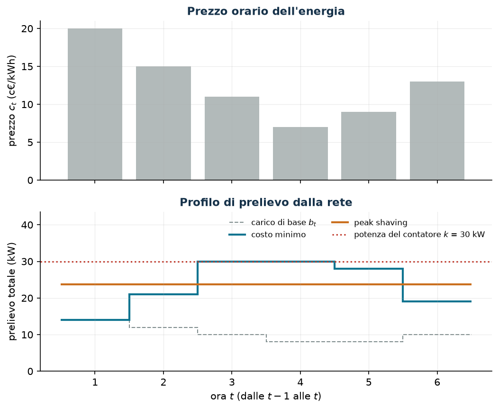
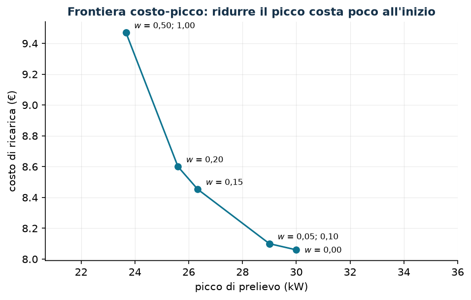

# Ricarica intelligente di veicoli elettrici

[:material-file-pdf-box: Dispensa (PDF)](pdf/dispensa-modellazione-pl.pdf) · [:material-presentation: Slide del capitolo (PDF)](pdf/slide-06-ricarica-ev.pdf) · [:material-gesture-tap: App: Ricarica notturna a costo minimo](laboratorio/ricarica-ev.md)

**Classe:** LP · **Script:** `python/lab06_ricarica_ev.py`

[](https://colab.research.google.com/github/fabiofurini/modellazione-pl/blob/main/notebooks/lab06_ricarica_ev.ipynb)

!!! nota "Prerequisiti"

    - Da questo modulo, [Capitolo 2 «Richiami: programmazione lineare e analisi di sensitività»](https://fabiofurini.github.io/modellazione-pl/teoria-lp/): i prezzi ombra e il protocollo di sensitività.

    - Da questo modulo, [Capitolo 3 «Il solver: costruire, risolvere, interpretare»](https://fabiofurini.github.io/modellazione-pl/solver-lp/): i bound delle variabili in `gurobipy` e il termine noto memorizzato dal solver.

!!! chiave "Obiettivi"

    Alla fine di questo capitolo sarai in grado di:

    - modellare decisioni su un orizzonte orario con finestre di disponibilità;

    - leggere i duali come prezzi delle ore marginali;

    - gestire il compromesso costo-picco con un obiettivo pesato;

    - diagnosticare una vera insidia dell'analisi di sensitività: il termine noto con le costanti.

Una flotta deve arrivare carica al mattino sfruttando le ore economiche — ma se
tutti caricano insieme, il picco di prelievo esplode. Un problema che *sembra*
richiedere variabili di accensione/spegnimento e invece è un LP puro: la decisione
vera — quanta potenza — è continua.

**Il problema a parole.** *Decidiamo* la potenza $x_{vt}$ per veicolo e ora.
*L'obiettivo*: minima spesa energetica. *I vincoli*: energia richiesta entro la
partenza, ricarica solo quando collegati e sotto la potenza del caricatore,
prelievo totale sotto la potenza del contatore.

## Modello

**Dati (input del modello).**

| Simbolo | Tipo | Significato |
|---|---|---|
| $n$ | $\in \mathbb{Z}_{\ge 1}$ | numero di veicoli, indicizzati da $v \in \{1, 2, \dots, n\}$ |
| $m$ | $\in \mathbb{Z}_{\ge 1}$ | numero di intervalli orari, indicizzati da $t \in \{1, 2, \dots, m\}$, di durata $d$ (qui $d = 1$ h) |
| $c_t$ | $\in \mathbb{Q}_{\ge 0}$ | prezzo dell'energia nell'ora $t$ (€/kWh) |
| $a_{vt}$ | $\in \{0, 1\}$ | *dato* osservato: $1$ se il veicolo $v$ è collegato nell'ora $t$, $0$ altrimenti |
| $e_v$ | $\in \mathbb{Q}_{> 0}$ | energia richiesta dal veicolo $v$ entro la partenza (kWh) |
| $\bar p_v$ | $\in \mathbb{Q}_{> 0}$ | potenza massima di ricarica del veicolo $v$ (kW) |
| $b_t$ | $\in \mathbb{Q}_{\ge 0}$ | carico di base dell'edificio nell'ora $t$ (kW) |
| $k$ | $\in \mathbb{Q}_{> 0}$ | potenza massima prelevabile dal contatore (kW) |
| $r$ | $\in \mathbb{Q},\ 0 < r \le 1$ | rendimento di carica |

**Variabili decisionali.** Introduciamo le seguenti $n\,m$ variabili non negative:

$$
x_{vt} = \text{potenza assegnata al veicolo } v \text{ nell'ora } t \text{ (kW)},
\qquad \forall v \in \{1, 2, \dots, n\},~\forall t \in \{1, 2, \dots, m\}.
$$

Usando queste variabili, un modello LP per il problema è il seguente:

$$
\begin{aligned}
\min ~~ \sum_{v=1}^{n} \sum_{t=1}^{m} c_t\, d\, x_{vt} & & \\
\text{soggetto a} \quad r \sum_{t=1}^{m} d\, x_{vt} &\ge e_v, & \forall v \in \{1, 2, \dots, n\}, \\
\sum_{v=1}^{n} x_{vt} + b_t &\le k, & \forall t \in \{1, 2, \dots, m\}, \\
x_{vt} &\le a_{vt}\, \bar p_v, & \forall v \in \{1, 2, \dots, n\},~\forall t \in \{1, 2, \dots, m\}, \\
x_{vt} &\ge 0, & \forall v \in \{1, 2, \dots, n\},~\forall t \in \{1, 2, \dots, m\}.
\end{aligned}
$$

Descrizione della funzione obiettivo e dei vincoli:

- la funzione obiettivo lineare minimizza la spesa energetica della notte: la potenza
  $x_{vt}$ erogata per la durata $d$ costa $c_t\, d\, x_{vt}$ euro;
- i vincoli lineari di **energia** assicurano che ogni veicolo riceva tutta l'energia
  richiesta entro la partenza; il rendimento $r$ sta a sinistra: dell'energia
  prelevata solo la frazione $r$ finisce in batteria ($n$ vincoli lineari);
- i vincoli lineari di **rete** impongono che il prelievo complessivo (ricarica più
  carico di base) non superi mai la potenza del contatore: sono i vincoli che
  accoppiano i veicoli tra loro ($m$ vincoli lineari);
- i vincoli lineari di **potenza** limitano la potenza di ogni veicolo al suo
  caricatore e la azzerano nelle ore in cui il veicolo è assente ($a_{vt} = 0$): la
  disponibilità è un *dato*, non una decisione, ed è per questo che non servono
  variabili binarie ($n\,m$ vincoli lineari);
- i vincoli di non negatività su $x_{vt}$ definiscono le variabili del modello.

Varianti: peak shaving ($\min z$ con $\sum_{v=1}^{n} x_{vt} + b_t \le z$ per ogni
$t \in \{1, 2, \dots, m\}$); multiobiettivo costo $+\,w\,z$.
Il vincolo di energia è scritto come $\ge$ perché caricare più del necessario è
ammesso ma mai conveniente (il prezzo è positivo): all'ottimo vale con uguaglianza.

!!! example "Esempio a mano (1 veicolo, 2 ore)"
    $e = 10$ kWh ($r = 1$), prezzi $c_1 = 0{,}10$ e $c_2 = 0{,}20$ €/kWh,
    $\bar p = 8$ kW: si carica 8 kWh nell'ora economica e 2 in quella cara (costo
    $8 \cdot 0{,}10 + 2 \cdot 0{,}20 = 1{,}20$ €). Prezzo ombra del fabbisogno
    = 0,20 €/kWh (il prezzo dell'*ora marginale*); prezzo ombra del limite di potenza
    nell'ora 1 = 0,10 €/kW. Con $\bar p = 12$: tutto nell'ora economica, costo 1,00 €,
    duale del fabbisogno 0,10 e duale della potenza 0 (vincolo non attivo).

## Caso di studio

Tre furgoni ($n = 3$) nelle sei ore dalle 0 alle 6 ($m = 6$, $d = 1$ h, l'ora $t$ va
dalle $t-1$ alle $t$), contatore $k = 30$ kW, rendimento $r = 0{,}9$ (dati in
`dati/ev_prezzi_base.csv` e `dati/ev_flotta.csv`). Le variabili sono 18, ma 6 valgono
0 perché il furgone non è collegato ($a_{vt} = 0$): restano 12 variabili, 3 vincoli
di energia e 6 vincoli di rete.

| ora $t$ | 1 | 2 | 3 | 4 | 5 | 6 |
|---|---|---|---|---|---|---|
| dalle–alle | 0–1 | 1–2 | 2–3 | 3–4 | 4–5 | 5–6 |
| $c_t$ (€/kWh) | 0,20 | 0,15 | 0,11 | 0,07 | 0,09 | 0,13 |
| $b_t$ (kW) | 14 | 12 | 10 | 8 | 8 | 10 |

| Furgone $v$ | collegato | ore con $a_{vt} = 1$ | $e_v$ (kWh) | $e_v/r$ (kWh prelevati) | $\bar p_v$ (kW) |
|---|---|---|---|---|---|
| 1 | dalle 0 alle 6 | 1–6 | 36 | 40 | 11 |
| 2 | dalle 0 alle 3 | 1–3 | 18 | 20 | 11 |
| 3 | dalle 3 alle 6 | 4–6 | 18 | 20 | 16 |

Senza il limite del contatore ogni furgone caricherebbe nelle sue ore più economiche e
il prelievo arriverebbe a 35 kW nell'ora 4 (8 di base, 11 del furgone 1, 16 del
furgone 3): con $k = 30$ kW una parte della ricarica deve spostarsi.

```text
Costo minimo   : 8,06 EUR/notte   picco di prelievo 30,0 kW (limite 30)
Potenza x[v,t] (kW), ore t = 1..6:
  V1:   0,0   0,0   9,0  11,0  11,0   9,0
  V2:   0,0   9,0  11,0     .     .     .
  V3:     .     .     .  11,0   9,0   0,0
Prezzi ombra del fabbisogno (EUR/kWh):  V1 0,1444   V2 0,1667   V3 0,1000
Prezzi ombra della rete (EUR/kW)     :  ore 3 e 4: 0,02   altre ore: 0
Peak shaving   : picco minimo possibile 23,7 kW
```



Le ore 3 e 4 sono sature: il prelievo tocca i 30 kW del contatore. I prezzi ombra del
fabbisogno valgono $0{,}1444 = 0{,}13/r$, $0{,}1667 = 0{,}15/r$ e $0{,}1000 = 0{,}09/r$:
sono i prezzi delle **ore marginali** di ciascun furgone (l'ora più cara che usa sotto
la potenza del caricatore), corretti per il rendimento. Il furgone 1 completa la
ricarica nell'ora 6, il furgone 2 nell'ora 2, il furgone 3 nell'ora 5.

Anche i prezzi ombra della rete sono differenze di prezzo fra due ore. Un kW in più
nell'ora 3 permette al furgone 1 di spostare un kWh dall'ora 6 all'ora 3
($0{,}13 - 0{,}11 = 0{,}02$ €); un kW in più nell'ora 4 permette al furgone 3 di
spostarlo dall'ora 5 all'ora 4 ($0{,}09 - 0{,}07 = 0{,}02$ €).

## Sensitività



```text
Compromesso costo + w*picco:
  w = 0,00: costo 8,06  picco 30,0     w = 0,15: costo 8,45  picco 26,3
  w = 0,05: costo 8,10  picco 29,0     w = 0,20: costo 8,60  picco 25,6
  w = 0,10: costo 8,10  picco 29,0     w = 0,50: costo 9,47  picco 23,7
Capacita' del contatore:
  k = 23 kW: INAMMISSIBILE     k = 28: 8,22     k = 32: 7,98
  k = 24 kW: 9,32              k = 30: 8,06     k = 35: 7,92
  k = 26 kW: 8,52
```

Tagliare il picco da 30 a 29 kW costa 4 centesimi a notte; scendere a 25,6 kW (−15%)
ne costa 54. Il picco minimo, 23,7 kW, costa 9,47 € (+1,41 €): il prelievo è piatto,
cioè i 142 kWh della notte (62 di base e 80 per i furgoni) divisi per le 6 ore. Il
costo dipende solo dal prelievo di ogni ora, quindi tutti i piani con il picco minimo
costano 9,47 €.

Con il contatore succede lo stesso: da 35 a 30 kW la spesa sale di 14 centesimi, da 30
a 24 kW di 1,26 €. Sotto 23,7 kW il problema è inammissibile, perché nemmeno il
prelievo piatto entra sotto il limite.

!!! warning "Un bug istruttivo (capitato davvero)"
    Nel vincolo `quicksum(x) + base[t] <= C` Gurobi sposta la costante nel termine
    noto: il RHS memorizzato è `C - base[t]`. Chi scrive `v.RHS = nuovaC` sta
    allentando il vincolo sbagliato. Quando una sensitività non cambia nulla,
    sospettare del proprio codice prima che del modello.


Un profilo di prelievo *regolare*, che penalizza le variazioni del prelievo da
un'ora all'altra, richiede un termine quadratico nell'obiettivo e non è più un LP: è
la variante quadratica di questo modello, nel modulo *Modellazione PNL*, pagina
[«Ricarica di veicoli elettrici con profilo regolare»](https://fabiofurini.github.io/modellazione-pnl/ricarica-ev-quadratica/).

## In sintesi

!!! chiave "In sintesi"

    - La ricarica intelligente è un LP puro: si decide quanta potenza, e la disponibilità è un dato, non una variabile binaria.

    - Le ore economiche si riempiono per prime; il prezzo ombra del fabbisogno di energia è il prezzo dell'ora marginale diviso per $r$.

    - Costo $+\,w\,$picco traccia la frontiera costo-picco: il picco scende molto per un piccolo aumento di costo.

    - Le costanti dei vincoli finiscono nel termine noto: se un'analisi di sensitività non cambia nulla, si controlla prima il codice.

## Codice

Lo script completo del capitolo — dati, modello, soluzione, sensitività e figure —
è [`python/lab06_ricarica_ev.py`](https://github.com/fabiofurini/modellazione-pl/blob/main/python/lab06_ricarica_ev.py)
(riproducibile con `python3 python/lab06_ricarica_ev.py` dalla cartella `python/`).

Lo stesso codice è disponibile come notebook — [`notebooks/lab06_ricarica_ev.ipynb`](https://github.com/fabiofurini/modellazione-pl/blob/main/notebooks/lab06_ricarica_ev.ipynb) — che si apre in Colab dal badge in cima alla pagina e gira nel browser, senza installare niente.

??? example "Mostra lo script completo — `lab06_ricarica_ev.py`"

    ```python
    """Capitolo 6 — Ricarica intelligente di veicoli elettrici (LP).

    Caso di studio: deposito aziendale con 3 furgoni elettrici da ricaricare
    nelle 6 ore dalle 0 alle 6; prezzi orari dell'energia; carico di base dell'edificio.

    Contenuto:
      1. LP a costo minimo: la ricarica insegue le ore economiche
      2. Peak shaving: minimizzare il picco di prelievo (minimax)
      3. Confronto multiobiettivo costo-picco
      4. Prezzi ombra: capacità di rete e fabbisogno energetico
    """
    import gurobipy as gp
    import pandas as pd
    from gurobipy import GRB

    from stile import (ARANCIO, GRIGIO, ROSSO, TEAL, intestazione, plt, salva_dat, salva_dati,
                       salva_figura)

    # ----------------------------------------------------------------------
    # 1. DATI
    # ----------------------------------------------------------------------
    ore = list(range(1, 7))                    # ora t = dalle t-1 alle t (t = 1: dalle 0 alle 1)
    # prezzo €/kWh: alto nelle prime ore (coda del picco serale), minimo dalle 3 alle 4
    prezzo = pd.Series([0.20, 0.15, 0.11, 0.07, 0.09, 0.13], index=ore)
    # carico di base dell'edificio (kW)
    base = pd.Series([14.0, 12.0, 10.0, 8.0, 8.0, 10.0], index=ore)

    veicoli = ["V1", "V2", "V3"]
    # (ora di arrivo, ora di partenza, energia richiesta kWh, potenza max kW)
    flotta = {
        "V1": (0, 6, 36, 11),     # collegato tutta la notte
        "V2": (0, 3, 18, 11),     # parte alle 3 per il primo turno
        "V3": (3, 6, 18, 16),     # rientra alle 3 dall'ultimo turno
    }
    eta = 0.9             # rendimento di carica
    C_rete = 30.0         # potenza massima prelevabile dal contatore (kW)

    # collegato nell'ora t (dalle t-1 alle t) se è arrivato entro le t-1 e parte alle t o più tardi
    disp = {(v, t): 1 if flotta[v][0] < t <= flotta[v][1] else 0
            for v in veicoli for t in ore}

    salva_dati(pd.DataFrame({"ora": ore, "prezzo": prezzo, "carico_base": base}), "ev_prezzi_base")
    salva_dati(pd.DataFrame([(v, *flotta[v]) for v in veicoli],
                            columns=["veicolo", "arrivo", "partenza", "energia_kWh", "pmax_kW"]),
               "ev_flotta")


    def costruisci():
        m = gp.Model("ricarica_ev")
        m.Params.OutputFlag = 0
        x = m.addVars(veicoli, ore, name="x")       # potenza di carica (kW)
        for v in veicoli:
            for t in ore:
                x[v, t].UB = flotta[v][3] * disp[v, t]     # 0 se non collegato
        v_ene = m.addConstrs((eta * gp.quicksum(x[v, t] for t in ore) >= flotta[v][2]
                              for v in veicoli), name="energia")
        v_rete = m.addConstrs((gp.quicksum(x[v, t] for v in veicoli) + base[t] <= C_rete
                               for t in ore), name="rete")
        return m, x, v_ene, v_rete


    def profilo(x):
        return pd.Series([sum(x[v, t].X for v in veicoli) for t in ore], index=ore)


    # ----------------------------------------------------------------------
    # 2. LP COSTO MINIMO
    # ----------------------------------------------------------------------
    intestazione("LP: costo energetico minimo")
    m, x, v_ene, v_rete = costruisci()
    m.setObjective(gp.quicksum(prezzo[t] * x[v, t] for v in veicoli for t in ore), GRB.MINIMIZE)
    m.optimize()
    assert m.Status == GRB.OPTIMAL
    prof_costo = profilo(x)
    costo_min = m.ObjVal
    picco_costo = (prof_costo + base).max()
    print(f"Costo di ricarica: {costo_min:.2f} €   picco di prelievo: {picco_costo:.1f} kW "
          f"(limite {C_rete:.0f})")
    print("\nPotenza x[v, t] (kW), ore t = 1..6:")
    for v in veicoli:
        print(f"  {v}: " + "  ".join(f"{x[v, t].X:5.1f}" if disp[v, t] else "    ." for t in ore))
    print("\nPrezzi ombra del fabbisogno (costo marginale di 1 kWh in più per veicolo):")
    for v in veicoli:
        print(f"  {v}: {v_ene[v].Pi:.4f} €/kWh")
    print("Prezzi ombra della rete (risparmio per 1 kW in più nell'ora t):")
    print("  " + "  ".join(f"t={t}: {abs(v_rete[t].Pi):.3f}" for t in ore))

    # ----------------------------------------------------------------------
    # 3. PEAK SHAVING (minimax) e COMPROMESSO COSTO-PICCO
    # ----------------------------------------------------------------------
    intestazione("Peak shaving: minimizzare il picco di prelievo")
    mp, xp, _, _ = costruisci()
    z = mp.addVar(name="picco")
    mp.addConstrs((gp.quicksum(xp[v, t] for v in veicoli) + base[t] <= z for t in ore),
                  name="def_picco")
    mp.setObjective(z, GRB.MINIMIZE)
    mp.optimize()
    prof_picco = profilo(xp)
    costo_picco = sum(prezzo[t] * prof_picco[t] for t in ore)
    print(f"Picco minimo possibile: {mp.ObjVal:.1f} kW   costo: {costo_picco:.2f} € "
          f"(+{costo_picco - costo_min:.2f} € rispetto al costo minimo)")

    intestazione("Compromesso: costo + w · picco")
    compromessi = []
    for rho in [0, 0.05, 0.1, 0.15, 0.2, 0.5, 1.0]:
        mc, xc, _, _ = costruisci()
        zc = mc.addVar(name="picco")
        mc.addConstrs((gp.quicksum(xc[v, t] for v in veicoli) + base[t] <= zc for t in ore))
        mc.setObjective(gp.quicksum(prezzo[t] * xc[v, t] for v in veicoli for t in ore)
                        + rho * zc, GRB.MINIMIZE)
        mc.optimize()
        cc = sum(prezzo[t] * xc[v, t].X for v in veicoli for t in ore)
        compromessi.append((rho, cc, zc.X))
        print(f"  w = {rho:4.2f}: costo {cc:6.2f} €, picco {zc.X:6.1f} kW")
    salva_dati(pd.DataFrame(compromessi, columns=["rho", "costo", "picco"]), "ev_compromessi")

    # ----------------------------------------------------------------------
    # 4. SENSITIVITÀ: capacità del contatore
    # ----------------------------------------------------------------------
    intestazione("Sensitività: capacità della connessione alla rete")
    # attenzione: nel vincolo "somma x + base[t] <= C" Gurobi sposta la costante base[t]
    # nel termine noto; il RHS memorizzato è C - base[t], quindi va aggiornato così:
    for CC in [23, 24, 26, 28, 30, 32, 35]:
        ms, xs_, _, vr = costruisci()
        for t in ore:
            vr[t].RHS = CC - base[t]
        ms.setObjective(gp.quicksum(prezzo[t] * xs_[v, t] for v in veicoli for t in ore),
                        GRB.MINIMIZE)
        ms.optimize()
        esito = f"costo {ms.ObjVal:6.2f} €" if ms.Status == GRB.OPTIMAL else "INAMMISSIBILE"
        print(f"  C_rete = {CC:3d} kW: {esito}")

    # ----------------------------------------------------------------------
    # 5. FIGURE (dati pgfplots + anteprima matplotlib)
    # ----------------------------------------------------------------------
    salva_dat(pd.DataFrame({"ora": ore, "prezzo_cent": prezzo * 100, "base": base,
                            "totcosto": base + prof_costo, "totpicco": base + prof_picco}),
              "cap06_profili")
    salva_dat(pd.DataFrame(compromessi, columns=["rho", "costo", "picco"]), "cap06_frontiera")
    # gradini larghi un'ora per pgfplots (const plot): bordi 0,5; 1,5; ...; 6,5, l'ultimo valore ripetuto
    bordi = [t - 0.5 for t in ore] + [ore[-1] + 0.5]


    def gradino(serie):
        return list(serie) + [serie.iloc[-1]]


    salva_dat(pd.DataFrame({"x": bordi, "base": gradino(base), "totcosto": gradino(base + prof_costo),
                            "totpicco": gradino(base + prof_picco)}), "cap06_gradini")

    fig, (ax1, ax2) = plt.subplots(2, 1, figsize=(8.2, 6.4), sharex=True)
    ax1.bar(ore, prezzo * 100, color=GRIGIO, alpha=0.6)
    ax1.set_ylabel("prezzo $c_t$ (c€/kWh)")
    ax1.set_title("Prezzo orario dell'energia")
    # stesse voci, colori e titolo dell'app del laboratorio; legenda sopra il limite del contatore
    # una colonna per ora: gradini larghi un'ora, dalle t-1 alle t (bordi come sopra)
    ax2.stairs(base, bordi, baseline=None, color=GRIGIO, ls="--", label="carico di base $b_t$")
    ax2.stairs(base + prof_costo, bordi, baseline=None, color=TEAL, lw=2, label="costo minimo")
    ax2.stairs(base + prof_picco, bordi, baseline=None, color=ARANCIO, lw=2, label="peak shaving")
    ax2.axhline(C_rete, color=ROSSO, ls=":", label=f"potenza del contatore $k$ = {C_rete:.0f} kW")
    ax2.set_ylim(0, C_rete * 1.45)
    ax2.set_xticks(ore); ax2.set_xlabel("ora $t$ (dalle $t-1$ alle $t$)"); ax2.set_ylabel("prelievo totale (kW)")
    ax2.set_title("Profilo di prelievo dalla rete")
    ax2.legend(fontsize=8, ncol=2, loc="upper right")
    salva_figura(fig, "cap06_profili")

    comp = pd.DataFrame(compromessi, columns=["rho", "costo", "picco"])
    fig, ax = plt.subplots()
    ax.plot(comp["picco"], comp["costo"], "-o", color=TEAL)
    # i pesi con lo stesso punto (stesso picco e costo) in un'unica etichetta
    gruppi = comp.groupby([comp["picco"].round(3), comp["costo"].round(4)], sort=False)
    for k, ((pk, cc), g) in enumerate(gruppi):
        pesi = "; ".join(f"{w:.2f}".replace(".", ",") for w in g["rho"])
        ax.annotate(f"$w$ = {pesi}", (pk, cc), textcoords="offset points", xytext=(8, -3 if k == 0 else 4),
                    fontsize=8)
    ax.set_xlim(comp["picco"].min() - 3, comp["picco"].max() + 6)
    ax.set_xlabel("picco di prelievo (kW)")
    ax.set_ylabel("costo di ricarica (€)")
    ax.set_title("Frontiera costo-picco: ridurre il picco costa poco all'inizio")
    salva_figura(fig, "cap06_frontiera")

    print("\nFatto: capitolo 6.")
    ```

## Esercizi

1. $e_1: 36 \to 37$ kWh: costo da 8,06 a 8,2044 €, $+0{,}1444 = 0{,}13/0{,}9$ (verificato).
2. Il furgone 3 rientra alle 4 invece che alle 3: come cambiano costo, ore sature e prezzi ombra?
3. Frontiera costo-emissioni con intensità carbonica oraria $g_t$.
4. Capacità minima ammissibile per bisezione: $\tilde k = 142/6 \approx 23{,}67$ kW.

<!-- laboratorio-interattivo: sezione generata da genera_laboratorio.py -->

## Laboratorio interattivo { #laboratorio-interattivo }

L'app di questo capitolo risolve il modello nel browser, con i dati del caso di studio. ▶ accanto a un cursore lo fa muovere da solo.
Si apre anche a tutta pagina nel [laboratorio interattivo](laboratorio/index.md): [Ricarica notturna a costo minimo](laboratorio/ricarica-ev.md).

<div class="gi gi-capitolo" data-grafico="pl-ricarica-ev"></div>
