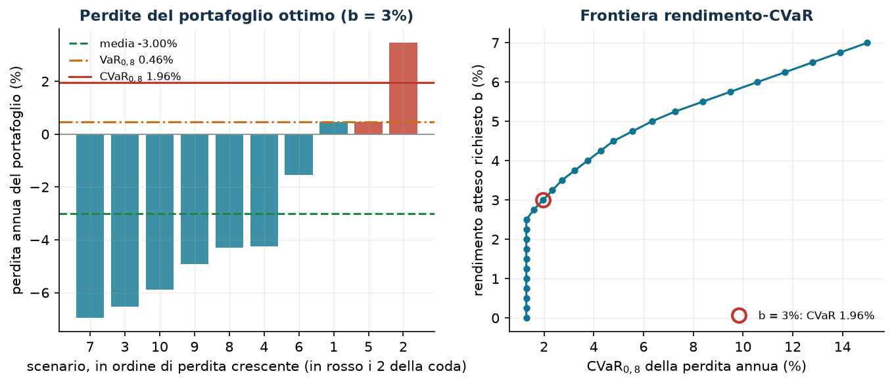

# VaR e CVaR: misurare e ottimizzare il rischio

[:material-file-pdf-box: Dispensa (PDF)](pdf/dispensa-modellazione-pl.pdf) · [:material-presentation: Slide del capitolo (PDF)](pdf/slide-09-var-cvar.pdf) · [:material-gesture-tap: App: VaR e CVaR: portafoglio a rischio di coda minimo](laboratorio/var-cvar.md)

**Classe:** LP a scenari · **Script:** `python/lab09_var_cvar.py`

[](https://colab.research.google.com/github/fabiofurini/modellazione-pl/blob/main/notebooks/lab09_var_cvar.ipynb)

!!! nota "Prerequisiti"

    - Da questo modulo, [Capitolo 8 «Il Newsvendor e le sue varianti»](https://fabiofurini.github.io/modellazione-pl/newsvendor/): l'LP a scenari, il trucco della parte positiva e l'obiettivo mean-CVaR.

    - Da questo modulo, [Capitolo 2 «Richiami: programmazione lineare e analisi di sensitività»](https://fabiofurini.github.io/modellazione-pl/teoria-lp/): i prezzi ombra e il protocollo di sensitività.

!!! chiave "Obiettivi"

    Alla fine di questo capitolo sarai in grado di:

    - definire e calcolare VaR e CVaR su una distribuzione discreta;

    - usare la formulazione lineare di Rockafellar–Uryasev;

    - costruire portafogli e piani logistici protetti dagli scenari peggiori;

    - riconoscere i limiti statistici delle stime delle code.

Ottimizzare il valore medio può nascondere perdite rare e molto elevate. Il **VaR**
(*Value-at-Risk*) risponde a "qual è una soglia di perdita elevata?"; il **CVaR**
(*Conditional Value-at-Risk*) anche a "quanto perdiamo *in media* quando la soglia
viene superata?". Sorpresa didattica: il CVaR si ottimizza con un semplice LP.

## Definizioni

Per una perdita aleatoria $L$ (maiuscola per aderenza alla letteratura — eccezione
alla convenzione che riserva le maiuscole a insiemi e matrici; realizzazioni
minuscole $\ell_s$) e un livello $\alpha \in (0,1)$:

$$
\mathrm{VaR}_\alpha(L) = \inf\{\eta : \mathbb{P}(L \le \eta) \ge \alpha\}
\qquad
\mathrm{CVaR}_\alpha(L) = \text{media della coda peggiore di massa } 1 - \alpha .
$$

| Proprietà | |
|---|---|
| Convessità | il CVaR è convesso nelle decisioni (se $L$ lo è); il VaR in generale no |
| Subadditività | il CVaR premia la diversificazione; il VaR può violarla |
| Coda | il VaR non distingue due code con lo stesso quantile ma gravità diversa |
| Ottimizzazione | il CVaR ammette una formulazione LP a scenari; il VaR no |

!!! example "Esempio a mano (6 scenari, α = 0,80)"
    Perdite equiprobabili $\{2, 4, 5, 7, 12, 20\}$: VaR $= 12$ (la cumulata tocca
    0,80 lì); CVaR $= 12 + \frac{1}{0{,}20}\cdot\frac{1}{6}(20 - 12) =
    \mathbf{18{,}67}$ — la formula tratta correttamente la massa "a cavallo" del
    quantile. Media $= 8{,}33$: tre numeri, tre storie.

## La formulazione lineare di Rockafellar–Uryasev

**Dati (input del modello).** Il numero di scenari $k \in \mathbb{Z}_{\ge 1}$,
indicizzati da $s \in \{1, 2, \dots, k\}$; per ogni scenario, la probabilità
$w_s \in \mathbb{Q}_{\ge 0}$ (con $\sum_{s=1}^{k} w_s = 1$) e la perdita
$\ell_s(\boldsymbol x)$, funzione lineare del vettore delle decisioni
$\boldsymbol x$, vincolato in un poliedro $X$; il livello di confidenza
$\alpha \in (0, 1)$.

**Variabili decisionali.** Oltre alle decisioni $\boldsymbol x$, introduciamo una
variabile libera e $k$ variabili non negative:

$$
\begin{cases}
\eta = \text{soglia candidata di perdita (all'ottimo: un VaR)}\\[1ex]
\xi_s = \text{eccesso di perdita oltre } \eta \text{ nello scenario } s
\end{cases}
\qquad \forall s \in \{1, 2, \dots, k\}.
$$

Usando queste variabili, il modello LP di Rockafellar–Uryasev è il seguente:

$$
\begin{aligned}
\min ~~ \eta + \frac{1}{1-\alpha} \sum_{s=1}^{k} w_s\, \xi_s & & \\
\text{soggetto a} \quad \xi_s &\ge \ell_s(\boldsymbol x) - \eta, & \forall s \in \{1, 2, \dots, k\}, \\
\boldsymbol x &\in X, & \\
\eta &\gtreqless 0, & \\
\xi_s &\ge 0, & \forall s \in \{1, 2, \dots, k\}.
\end{aligned}
$$

Descrizione della funzione obiettivo e dei vincoli:

- la funzione obiettivo lineare è la soglia $\eta$ più la media pesata degli eccessi
  di coda, amplificata di $1/(1-\alpha)$; *all'ottimo $\tilde\eta$ è un VaR e il
  valore obiettivo è il CVaR*: un solo LP fornisce entrambe le misure;
- i vincoli lineari di **coda** definiscono gli eccessi: solo gli scenari con perdita
  oltre la soglia contribuiscono ($k$ vincoli lineari);
- il vincolo $\boldsymbol x \in X$ raccoglie i vincoli (poliedrali) del problema
  decisionale sottostante;
- i vincoli su $\eta$ e $\xi_s$ definiscono le variabili: $\eta$ è libera (il simbolo
  $\gtreqless$, in Gurobi `addVar(lb=-GRB.INFINITY)`), le $\xi_s$ non negative.

La variabile $\xi_s = (\ell_s - \eta)^+$ è l'eccesso di perdita oltre la soglia
candidata $\eta$ (stesso trucco delle parti positive del Newsvendor). Minimizzare su
$\eta$ bilancia due spinte: alzare $\eta$ riduce gli eccessi ma sposta in su la
soglia; il punto di equilibrio è esattamente il quantile $\alpha$.

## Caso di studio 1: portafoglio mean-CVaR

Tre titoli — TEC (tecnologia), UTL (servizi di pubblica utilità) e ORO (oro) — e
$k = 10$ scenari annui equiprobabili ($w_s = 1/10$) del rendimento, in % (dati in
`dati/cvar_scenari_rendimenti.csv`). Nello scenario 1 i mercati crollano e l'oro sale;
negli scenari 2 e 9 l'oro scende. L'ultima colonna è il rendimento atteso $m_i$, la
media dei 10 scenari.

| titolo | $s = 1$ | 2 | 3 | 4 | 5 | 6 | 7 | 8 | 9 | 10 | $m_i$ |
|---|---|---|---|---|---|---|---|---|---|---|---|
| TEC ($i = 1$) | −25 | 5 | 30 | 5 | 0 | −5 | 20 | 10 | 25 | 5 | **7** |
| UTL ($i = 2$) | −8 | 2 | 6 | 4 | 5 | −6 | 8 | 3 | 7 | 9 | **3** |
| ORO ($i = 3$) | 15 | −10 | −5 | 4 | −3 | 8 | 0 | 2 | −6 | 5 | **1** |

Decidiamo le quote $x_i$ del capitale nei tre titoli. La perdita dello scenario è
$\ell_s(\boldsymbol x) = -\sum_{i=1}^{3} r_{is}\, x_i$, dove $r_{is}$ è il rendimento
del titolo $i$ nello scenario $s$; il poliedro $X$ chiede quote non negative che
sommano a 1 e un rendimento atteso $\sum_i m_i x_i$ di almeno $b = 3\%$.
Minimizziamo $\mathrm{CVaR}_{0,8}$: con 10 scenari la coda $1 - \alpha = 0{,}2$ sono
esattamente i 2 scenari peggiori.

L'LP ha 14 variabili ($x_1, x_2, x_3$, $\eta$ e le 10 $\xi_s$) e 12 vincoli. Nella
funzione obiettivo ogni $\xi_s$ ha coefficiente $w_s/(1-\alpha) = 1/(10 \cdot 0{,}2) =
0{,}5$; la riga di coda $\xi_s \ge -\sum_i r_{is} x_i - \eta$ si scrive con le
variabili a sinistra:

$$
\begin{array}{rrcrcrcrcrcl}
\min & & & & & & & \eta & + & 0{,}5 \textstyle\sum_{s=1}^{10} \xi_s & & \\[1ex]
\text{soggetto a} & 7\,x_1 & + & 3\,x_2 & + & x_3 & & & & & \ge & 3, \\
 & x_1 & + & x_2 & + & x_3 & & & & & = & 1, \\[1ex]
 & -25\,x_1 & - & 8\,x_2 & + & 15\,x_3 & + & \eta & + & \xi_1 & \ge & 0, \\
 & 5\,x_1 & + & 2\,x_2 & - & 10\,x_3 & + & \eta & + & \xi_2 & \ge & 0, \\
 & 30\,x_1 & + & 6\,x_2 & - & 5\,x_3 & + & \eta & + & \xi_3 & \ge & 0, \\
 & 5\,x_1 & + & 4\,x_2 & + & 4\,x_3 & + & \eta & + & \xi_4 & \ge & 0, \\
 & & & 5\,x_2 & - & 3\,x_3 & + & \eta & + & \xi_5 & \ge & 0, \\
 & -5\,x_1 & - & 6\,x_2 & + & 8\,x_3 & + & \eta & + & \xi_6 & \ge & 0, \\
 & 20\,x_1 & + & 8\,x_2 & & & + & \eta & + & \xi_7 & \ge & 0, \\
 & 10\,x_1 & + & 3\,x_2 & + & 2\,x_3 & + & \eta & + & \xi_8 & \ge & 0, \\
 & 25\,x_1 & + & 7\,x_2 & - & 6\,x_3 & + & \eta & + & \xi_9 & \ge & 0, \\
 & 5\,x_1 & + & 9\,x_2 & + & 5\,x_3 & + & \eta & + & \xi_{10} & \ge & 0, \\[1ex]
 & & & & & & & \eta & & & \gtreqless & 0, \\
 & x_1, & & x_2, & & x_3, & & & & \xi_s & \ge & 0, \quad s = 1, \dots, 10.
\end{array}
$$

```text
alpha = 0,8, b = 3%: 14 variabili, 12 vincoli
quote ottime: TEC 26,0%   UTL 22,0%   ORO 52,0%
  s        1     2     3     4     5     6     7     8     9    10
perdita 0,46  3,46 -6,52 -4,26  0,46 -1,54 -6,96 -4,30 -4,92 -5,88
perdita media -3,00%   VaR80 0,46%   CVaR80 1,96%
prezzo ombra del vincolo di rendimento: 1,51
```



La coda sono lo scenario 2, dove l'oro perde il 10% (perdita 3,46%), e la massa che
resta sul VaR, 0,46%, la perdita comune agli scenari 1 e 5: CVaR $= (3{,}46 +
0{,}46)/2 = 1{,}96\%$. L'ottimo pareggia le perdite degli scenari 1 e 5: spostare
capitale dall'uno all'altro peggiorerebbe la coda.

Il portafoglio diversifica. L'oro rende solo l'1% in media, ma pesa il 52%: guadagna
nel crollo dello scenario 1, dove TEC perde il 25%. Il CVaR guarda solo dove fa male,
le perdite oltre il VaR.

**Il prezzo ombra e la frontiera.** Il prezzo ombra del vincolo di rendimento vale
1,51: un punto di rendimento richiesto in più costa circa 1,51 punti di CVaR. La
frontiera ripete l'LP per $b$ da 0 al 7%, a passi di 0,25:

```text
    b    CVaR     TEC    UTL    ORO   ombra
 0,00    1,29   12,2%  41,1%  46,7%    0,00
 2,50    1,29   12,2%  41,1%  46,7%    0,00
 3,00    1,96   26,0%  22,0%  52,0%    1,51
 4,25    4,27   54,2%   0,0%  45,8%    2,08
 5,00    6,33   66,7%   0,0%  33,3%    3,08
 6,00   10,58   83,3%   0,0%  16,7%    4,42
 7,00   15,00  100,0%   0,0%   0,0%    4,42
b = 7,25%: inammissibile (nessun titolo rende piu' del 7%)
```

Fino a $b = 2{,}56\%$ il vincolo non è attivo: il portafoglio a CVaR minimo (CVaR
1,29%) rende già il 2,56%, e il prezzo ombra è 0. Oltre, alzare $b$ sposta il capitale
su TEC: UTL esce poco sopra il 3,5%, e il prezzo ombra cresce a ogni tratto (1,51;
2,08; 3,08; 4,42), perché la frontiera è convessa. Con $b = 7\%$ resta il solo TEC;
oltre il 7% l'LP è inammissibile.

**Il livello $\alpha$.** Con $b = 3\%$, il livello decide quanti scenari formano la coda:

```text
alpha = 0,5 (coda di 5 scenari): CVaR -0,53% | TEC 33,3%  UTL  0,0%  ORO 66,7%
alpha = 0,7 (coda di 3 scenari): CVaR  1,29% | TEC 22,0%  UTL 34,0%  ORO 44,0%
alpha = 0,8 (coda di 2 scenari): CVaR  1,96% | TEC 26,0%  UTL 22,0%  ORO 52,0%
alpha = 0,9 (coda di 1 scenario): CVaR  2,20% | TEC 20,0%  UTL 40,0%  ORO 40,0%
```

Con $\alpha = 0{,}9$ la coda è il solo crollo dello scenario 1, e le quote si spostano su
UTL, che lì perde poco. Con $\alpha = 0{,}5$ la coda è metà degli scenari e il CVaR è
negativo: nei 5 anni peggiori il portafoglio guadagna ancora, in media.

Misurare il rischio con la varianza invece che con il CVaR porta al portafoglio di
Markowitz, un modello quadratico: è nel modulo *Modellazione PNL*, pagina
[«Portafoglio di Markowitz»](https://fabiofurini.github.io/modellazione-pnl/markowitz/).

## Caso di studio 2: supply chain a due stadi

Prima di osservare lo scenario si *prenota* capacità dai fornitori; poi, visto lo
scenario, si decide il ricorso. F1 è economico ma fragile: negli scenari 4 e 9 consegna
solo metà della capacità prenotata. F2 è caro ma affidabile. Prenotare costa 2 € per
unità da F1 e 3 € da F2; l'acquisto costa 4 € per unità da entrambi; ogni unità di
domanda non servita costa 10 €. Gli scenari sono $k = 10$, equiprobabili, e il livello
è $\alpha = 0{,}8$, come nel portafoglio.

| scenario $s$ | 1 | 2 | 3 | 4 | 5 | 6 | 7 | 8 | 9 | 10 |
|---|---|---|---|---|---|---|---|---|---|---|
| domanda $d_s$ | 80 | 90 | 100 | 100 | 110 | 110 | 120 | 120 | 130 | 140 |
| disponibilità di F1, $q_{1s}$ | 1 | 1 | 1 | **0,5** | 1 | 1 | 1 | 1 | **0,5** | 1 |

**Dati.** Due fornitori indicizzati da $a \in \{1, 2\}$ con costi di prenotazione
$c^{\mathrm{pre}}_a \in \mathbb{Q}_{>0}$ e di acquisto
$c^{\mathrm{uso}}_a \in \mathbb{Q}_{>0}$; $k$ scenari $s \in \{1, 2, \dots, k\}$ con
domanda $d_s \in \mathbb{Q}_{\ge 0}$ e disponibilità $q_{as} \in (0, 1]$ (il
dato che modella il guasto); penalità per la domanda non servita $g \in \mathbb{Q}_{>0}$;
peso del rischio $r \in [0, 1]$ e livello $\alpha \in (0,1)$.

**Variabili decisionali.** Le variabili non negative $x_a$ (capacità prenotata dal
fornitore $a$, *di primo stadio*: uguale in tutti gli scenari), $f_{as}$ (acquisto
dal fornitore $a$ nello scenario $s$) e $u_s$ (domanda non servita nello scenario
$s$), queste ultime *di ricorso*.

$$
\begin{aligned}
\min ~~ (1-r) \Bigl[ \sum_{a=1}^{2} c^{\mathrm{pre}}_a x_a + \sum_{s=1}^{k} w_s\, \phi_s \Bigr] + r\, \mathrm{CVaR}_\alpha & & \\
\text{soggetto a} \quad f_{as} &\le q_{as}\, x_a, & \forall a \in \{1, 2\},~\forall s \in \{1, 2, \dots, k\}, \\
f_{1s} + f_{2s} + u_s &\ge d_s, & \forall s \in \{1, 2, \dots, k\}, \\
x_a,\ f_{as},\ u_s &\ge 0, & \forall a \in \{1, 2\},~\forall s \in \{1, 2, \dots, k\},
\end{aligned}
$$

dove $\phi_s = \sum_{a=1}^{2} c^{\mathrm{uso}}_a f_{as} + g\, u_s$ è il costo di
ricorso dello scenario $s$ e $\mathrm{CVaR}_\alpha$ è il CVaR del costo totale,
linearizzato con le variabili $\eta$ e $\xi_s$ del modello di Rockafellar–Uryasev.

Descrizione della funzione obiettivo e dei vincoli:

- la funzione obiettivo combina, con peso $r$, il costo medio (prenotazioni più
  valore atteso di acquisti e penalità) e il CVaR del costo totale;
- i vincoli lineari di **capacità** impongono che nello scenario $s$ si possa usare il
  fornitore $a$ solo fino alla capacità prenotata $x_a$, ridotta dalla disponibilità
  $q_{as}$ ($2\,k$ vincoli lineari);
- i vincoli lineari di **domanda** impongono di coprire $d_s$ con gli acquisti o, in
  mancanza, di conteggiarla come domanda non servita $u_s$, che in obiettivo paga la
  penalità: il modello non è mai inammissibile, "compra" l'inammissibilità al prezzo
  della penalità ($k$ vincoli lineari);
- i vincoli di non negatività su $x_a$, $f_{as}$ e $u_s$ definiscono le variabili del
  modello.

Con i 10 scenari il modello ha 32 variabili ($x_1$, $x_2$, 20 acquisti e 10 domande non
servite) e 30 vincoli; con il CVaR si aggiungono $\eta$, le 10 $\xi_s$ e 10 righe: 43
variabili e 40 vincoli. Per lo scenario 4, per esempio: $f_{14} \le 0{,}5\,x_1$,
$f_{24} \le x_2$ e $f_{14} + f_{24} + u_4 \ge 100$.

```text
r = 0,00: prenoto F1 120  F2   0   costo medio 758   CVaR80 1050   servizio  89,2%
r = 0,50: prenoto F1  80  F2  60   costo medio 798   CVaR80  970   servizio  97,7%
r = 0,75: prenoto F1  20  F2 120   costo medio 840   CVaR80  940   servizio 100,0%
```

Il decisore neutrale ($r = 0$) prenota 120 unità dal solo F1 e accetta i due scenari più
costosi: il 9, guasto con domanda 130 (1180 €), e il 10, domanda 140 oltre la capacità
(920 €). CVaR $= (1180 + 920)/2 = 1050$ €. Al crescere di $r$ la capacità migra verso
il fornitore affidabile: con $r = 0{,}5$, **+40 € di costo medio comprano −80 € di
CVaR** — il costo della resilienza, quantificato. Con $r = 0{,}75$ si serve tutta la
domanda, per altri 42 € di costo medio e 30 € di CVaR in meno. Con $r = 1$ conterebbe solo la coda:
gli acquisti negli altri scenari non sarebbero più determinati.

## Analisi di sensitività

| Parametro | Effetto atteso |
|---|---|
| $\alpha$ | più alto ⇒ coda più estrema stimata da meno scenari: servono più scenari per stime stabili |
| $r$ | controlla il compromesso prestazione media / protezione |
| $w_s$ | scenari ripesati o stress test (aggiungere scenari estremi) |
| $k$ | stabilità statistica: ripetere con campioni diversi, come nel Newsvendor |

!!! warning "Limiti statistici"
    Con $\alpha = 0{,}9$ e $k = 10$ scenari la coda contiene un solo scenario: il CVaR
    stimato è la perdita di quell'anno. Con dati veri servono almeno qualche decina di
    scenari *oltre* il quantile. Inoltre con distribuzioni discrete il VaR può non
    essere unico ($\tilde\eta$ è *un* VaR): confrontare sempre $\tilde\eta$ con il
    quantile empirico.


## In sintesi

!!! chiave "In sintesi"

    - Il VaR è una soglia di perdita alta, il quantile $\alpha$; il CVaR è la perdita media nella coda oltre la soglia.

    - Il CVaR è convesso, subadditivo e sensibile alla gravità della coda; il VaR no.

    - L'LP di Rockafellar–Uryasev usa una soglia libera $\eta$ e gli eccessi $\xi_s \ge 0$: all'ottimo $\eta^*$ è un VaR e il valore è il CVaR.

    - Le code estreme stimate da pochi scenari sono rumorose: servono decine di scenari oltre il quantile.

## Codice

Lo script completo del capitolo — dati, modello, soluzione, sensitività e figure —
è [`python/lab09_var_cvar.py`](https://github.com/fabiofurini/modellazione-pl/blob/main/python/lab09_var_cvar.py)
(riproducibile con `python3 python/lab09_var_cvar.py` dalla cartella `python/`).

Lo stesso codice è disponibile come notebook — [`notebooks/lab09_var_cvar.ipynb`](https://github.com/fabiofurini/modellazione-pl/blob/main/notebooks/lab09_var_cvar.ipynb) — che si apre in Colab dal badge in cima alla pagina e gira nel browser, senza installare niente.

??? example "Mostra lo script completo — `lab09_var_cvar.py`"

    ```python
    """Capitolo 9 — VaR e CVaR: modelli lineari e applicazioni (LP a scenari).

    Contenuto:
      1. Esempio a 6 scenari: VaR = 12, CVaR = 18,67,
         verificato con la formulazione lineare di Rockafellar-Uryasev
      2. Portafoglio a CVaR minimo: 3 titoli (TEC, UTL, ORO), 10 scenari annui equiprobabili,
         alpha = 0,8 (la coda sono i 2 scenari peggiori), rendimento atteso almeno b = 3%
      3. Frontiera rendimento-CVaR al variare di b, prezzo ombra del vincolo di rendimento
         ed effetto del livello alpha
      4. Scelta dei fornitori a due stadi (2 fornitori, 10 scenari): il costo della resilienza
    """
    import gurobipy as gp
    import numpy as np
    import pandas as pd
    from gurobipy import GRB

    from stile import (ARANCIO, GRIGIO, ROSSO, TEAL, VERDE, intestazione, plt, salva_dat,
                       salva_dati, salva_figura)

    # ----------------------------------------------------------------------
    # 1. ESEMPIO A 6 SCENARI
    # ----------------------------------------------------------------------
    intestazione("Esempio a 6 scenari: VaR e CVaR con la formulazione lineare")
    perdite = np.array([2.0, 4.0, 5.0, 7.0, 12.0, 20.0])
    pi6 = np.full(6, 1 / 6)
    alpha = 0.80

    # calcolo diretto
    cum = np.cumsum(pi6)
    var_diretto = perdite[np.searchsorted(cum, alpha)]
    print(f"Perdite: {perdite.tolist()}, probabilità 1/6 ciascuna, alpha = {alpha}")
    print(f"VaR (quantile): {var_diretto:.2f}")

    # formulazione lineare di Rockafellar-Uryasev: min eta + 1/(1-alpha) sum pi_s xi_s
    m = gp.Model("cvar6")
    m.Params.OutputFlag = 0
    eta = m.addVar(lb=-GRB.INFINITY, name="eta")
    xi = m.addVars(6, name="xi")
    m.addConstrs((xi[s] >= perdite[s] - eta for s in range(6)), name="coda")
    m.setObjective(eta + gp.quicksum(pi6[s] * xi[s] for s in range(6)) / (1 - alpha),
                   GRB.MINIMIZE)
    m.optimize()
    print(f"LP di Rockafellar-Uryasev: eta* = {eta.X:.2f} (un VaR), CVaR = {m.ObjVal:.4f}")
    print(f"Conto a mano: 12 + (1/0,20)·(1/6)·(20-12) = 12 + 6,67 = 18,67  ✓")
    print(f"Valore atteso della perdita: {perdite.mean():.2f} "
          f"→ il CVaR racconta la coda, la media no.")


    def var_cvar(perd, alpha):
        """VaR_alpha e CVaR_alpha esatto di k scenari equiprobabili.

        VaR = quantile alpha (la (ceil(alpha*k))-esima perdita in ordine crescente);
        CVaR = VaR + 1/((1-alpha) k) * sum_s max(l_s - VaR, 0), il valore della formula di
        Rockafellar-Uryasev: con perdite uguali al VaR conta esattamente (1-alpha) k scenari.
        """
        ordinate = np.sort(perd)
        k = len(ordinate)
        var_ = ordinate[int(np.ceil(alpha * k - 1e-9)) - 1]
        cvar_ = var_ + np.maximum(ordinate - var_, 0).sum() / ((1 - alpha) * k)
        return var_, cvar_


    # ----------------------------------------------------------------------
    # 2. PORTAFOGLIO A CVaR MINIMO
    # ----------------------------------------------------------------------
    intestazione("Portafoglio a CVaR minimo (LP): 3 titoli, 10 scenari")
    titoli = ["TEC", "UTL", "ORO"]
    # rendimento annuo r_is (%) del titolo i nello scenario s, 10 scenari equiprobabili:
    # nello scenario 1 i mercati crollano e l'oro sale; negli scenari 2 e 9 l'oro scende
    R = np.array([[-25, -8, 15],
                  [5, 2, -10],
                  [30, 6, -5],
                  [5, 4, 4],
                  [0, 5, -3],
                  [-5, -6, 8],
                  [20, 8, 0],
                  [10, 3, 2],
                  [25, 7, -6],
                  [5, 9, 5]], dtype=float)
    k, n = R.shape
    dati = pd.DataFrame(R, columns=titoli)
    dati.insert(0, "scenario", range(1, k + 1))
    salva_dati(dati, "cvar_scenari_rendimenti")
    mu = R.mean(axis=0)                       # rendimento atteso m_i (%): 7, 3, 1
    alpha_c = 0.80                            # la coda: (1 - 0,8) * 10 = 2 scenari
    b_obb = 3.0                               # rendimento atteso minimo richiesto (%)

    print(" s  " + "".join(f"{t:>6}" for t in titoli))
    for s in range(k):
        print(f"{s + 1:2d}  " + "".join(f"{R[s, i]:6.0f}" for i in range(n)))
    print("m_i " + "".join(f"{mu[i]:6.0f}" for i in range(n)) + "   (rendimento atteso, %)")


    def porta_cvar(b, alpha=alpha_c):
        """min CVaR_alpha della perdita -R x  soggetto a  rendimento atteso >= b, quote che sommano a 1.

        Restituisce quote, CVaR (valore ottimo) e prezzo ombra del vincolo di rendimento,
        oppure None se nessun portafoglio rende almeno b."""
        m = gp.Model("cvar_min")
        m.Params.OutputFlag = 0
        x = m.addVars(n, name="x")
        eta = m.addVar(lb=-GRB.INFINITY, name="eta")
        xi = m.addVars(k, name="xi")
        m.addConstr(x.sum() == 1, name="bilancio")
        rend = m.addConstr(gp.quicksum(mu[i] * x[i] for i in range(n)) >= b, name="rendimento")
        m.addConstrs((xi[s] >= -gp.quicksum(R[s, i] * x[i] for i in range(n)) - eta
                      for s in range(k)), name="coda")
        m.setObjective(eta + gp.quicksum(xi[s] for s in range(k)) / (k * (1 - alpha)),
                       GRB.MINIMIZE)
        m.optimize()
        if m.Status != GRB.OPTIMAL:
            return None
        return np.array([x[i].X for i in range(n)]), m.ObjVal, rend.Pi


    x_ott, cvar_ott, ombra = porta_cvar(b_obb)
    perd = -R @ x_ott
    var_ott, _ = var_cvar(perd, alpha_c)
    print(f"\nalpha = {alpha_c}, b = {b_obb:.0f}%: {n + 1 + k} variabili, {k + 2} vincoli")
    print("Quote ottime: " + ", ".join(f"{titoli[i]} {x_ott[i]:.1%}" for i in range(n)))
    print(f"{'s':>3} {'perdita %':>10} {'xi_s':>6}")
    for s in range(k):
        print(f"{s + 1:3d} {perd[s]:10.2f} {max(perd[s] - var_ott, 0):6.2f}")
    print(f"perdita media {perd.mean():.2f}% (rendimento atteso {-perd.mean():.2f}%), "
          f"VaR80 {var_ott:.2f}%, CVaR80 {cvar_ott:.2f}%")
    print(f"Prezzo ombra del vincolo di rendimento: {ombra:.4f} "
          f"(un punto di rendimento in più costa {ombra:.2f} punti di CVaR)")
    # le perdite in ordine crescente; coda = 1 per i 2 scenari peggiori (a pari merito, l'ultimo in ordine)
    ordine = np.argsort(perd, kind="stable")
    salva_dat(pd.DataFrame({"posto": range(1, k + 1), "scenario": ordine + 1, "perdita": perd[ordine],
                            "coda": [0] * (k - 2) + [1, 1]}), "cap09_perdite")
    salva_dat(pd.DataFrame({"stat": ["media", "VaR", "CVaR"],
                            "valore": [perd.mean(), var_ott, cvar_ott]}), "cap09_soglie")

    # ----------------------------------------------------------------------
    # 3. FRONTIERA RENDIMENTO-CVaR ED EFFETTO DI ALPHA
    # ----------------------------------------------------------------------
    intestazione("Frontiera rendimento-CVaR (alpha = 0,8)")
    righe = []
    for b in np.arange(0, mu.max() + 1e-9, 0.25):
        x, cv, pi = porta_cvar(b)
        righe.append((b, cv, *x, pi))
    front = pd.DataFrame(righe, columns=["rend", "cvar", *titoli, "ombra"])
    salva_dat(front, "cap09_frontiera")
    print(f"{'b':>5} {'CVaR':>7} " + "".join(f"{t:>7}" for t in titoli) + f" {'ombra':>7}")
    for r in front.itertuples(index=False):
        if r.rend in (0, 2.5, 3, 3.5, 4.25, 5, 6, 7):
            print(f"{r.rend:5.2f} {r.cvar:7.2f} " + "".join(f"{q:7.1%}" for q in r[2:2 + n]) + f" {r.ombra:7.2f}")
    x0, cv0, _ = porta_cvar(0)
    print(f"CVaR minimo {cv0:.2f}% con rendimento atteso {mu @ x0:.2f}%: per b sotto questo valore "
          f"il vincolo di rendimento non è attivo (prezzo ombra 0)")
    print(f"b = {mu.max() + 0.25:.2f}%: {'inammissibile' if porta_cvar(mu.max() + 0.25) is None else 'ammissibile'} "
          f"(nessun titolo rende più del {mu.max():.0f}%)")

    intestazione("Effetto del livello alpha (b = 3%)")
    for a in [0.5, 0.6, 0.7, 0.8, 0.9]:
        x, cv, pi = porta_cvar(b_obb, a)
        print(f"alpha = {a:.1f} (coda di {(1 - a) * k:.0f} scenari): CVaR {cv:6.2f}% | "
              + ", ".join(f"{titoli[i]} {x[i]:.1%}" for i in range(n)))

    # ----------------------------------------------------------------------
    # 4. SCELTA DEI FORNITORI A DUE STADI
    # ----------------------------------------------------------------------
    intestazione("Fornitori a due stadi: capacità prenotata + ricorso")
    # Due fornitori (F1 economico ma fragile, F2 caro ma affidabile) → un mercato.
    # 1° stadio: capacità prenotata x_a.  2° stadio, in ogni scenario: acquisti f_as e domanda non servita u_s.
    forn = ["F1", "F2"]
    c_pren = {"F1": 2.0, "F2": 3.0}         # costo di prenotazione €/unità
    c_uso = {"F1": 4.0, "F2": 4.0}          # costo di acquisto €/unità, uguale per i due fornitori
    pen = 10.0                              # penalità per unità di domanda non servita
    dom_s = np.array([80, 90, 100, 100, 110, 110, 120, 120, 130, 140], dtype=float)
    Ss = len(dom_s)
    # disponibilità del fornitore fragile: negli scenari 4 e 9 consegna solo metà della capacità
    disp_f1 = np.array([1, 1, 1, 0.5, 1, 1, 1, 1, 0.5, 1])
    disp = {"F1": disp_f1, "F2": np.ones(Ss)}
    alpha_f = 0.80                          # anche qui la coda sono i 2 scenari più costosi
    print(f"{Ss} scenari equiprobabili: domanda {dom_s.astype(int).tolist()}, F1 al 50% negli scenari 4 e 9")
    print(f"{2 + 3 * Ss} variabili e {3 * Ss} vincoli; con il CVaR {3 + 4 * Ss} e {4 * Ss}")


    def duestadi(lam, alpha_c2=alpha_f):
        m = gp.Model("duestadi")
        m.Params.OutputFlag = 0
        x = m.addVars(forn, name="x")
        f = m.addVars(forn, range(Ss), name="f")
        u = m.addVars(range(Ss), name="u")
        for s in range(Ss):
            for a in forn:
                m.addConstr(f[a, s] <= disp[a][s] * x[a])
            m.addConstr(gp.quicksum(f[a, s] for a in forn) + u[s] >= dom_s[s])
        costo1 = gp.quicksum(c_pren[a] * x[a] for a in forn)
        costo2 = {s: gp.quicksum(c_uso[a] * f[a, s] for a in forn) + pen * u[s]
                  for s in range(Ss)}
        atteso = costo1 + gp.quicksum(costo2[s] for s in range(Ss)) / Ss
        if lam > 0:
            eta = m.addVar(lb=-GRB.INFINITY)
            xi = m.addVars(range(Ss))
            m.addConstrs((xi[s] >= costo1 + costo2[s] - eta for s in range(Ss)))
            cvar = eta + gp.quicksum(xi[s] for s in range(Ss)) / (Ss * (1 - alpha_c2))
            m.setObjective((1 - lam) * atteso + lam * cvar, GRB.MINIMIZE)
        else:
            m.setObjective(atteso, GRB.MINIMIZE)
        m.optimize()
        assert m.Status == GRB.OPTIMAL, m.Status
        tot = np.array([c_pren["F1"] * x["F1"].X + c_pren["F2"] * x["F2"].X
                        + sum(c_uso[a] * f[a, s].X for a in forn) + pen * u[s].X
                        for s in range(Ss)])
        serv = np.array([1 - u[s].X / dom_s[s] for s in range(Ss)])
        return {a: x[a].X for a in forn}, tot, serv


    # con r = 1 conterebbe solo la coda: gli acquisti negli altri scenari non sarebbero determinati
    righe = []
    for lam in [0.0, 0.5, 0.75]:
        cap, tot, serv = duestadi(lam)
        _, cvar_t = var_cvar(tot, alpha_f)
        righe.append((lam, cap["F1"], cap["F2"], tot.mean(), cvar_t, serv.mean()))
        print(f"  r = {lam:4.2f}: prenoto F1 = {cap['F1']:5.1f}, F2 = {cap['F2']:5.1f} | "
              f"costo medio {tot.mean():6.1f}, CVaR80 {cvar_t:6.1f} | servizio medio {serv.mean():.1%}")
        print("          costo per scenario: " + " ".join(f"{c:.0f}" for c in tot))
    res2 = pd.DataFrame(righe, columns=["lam", "F1", "F2", "costo_medio", "cvar", "servizio"])
    salva_dat(res2, "cap09_duestadi")
    print("Il decisore avverso al rischio prenota più capacità dal fornitore affidabile:")
    print("paga di più in media, ma taglia la coda degli scenari con domanda non servita.")

    # ----------------------------------------------------------------------
    # 5. FIGURE
    # ----------------------------------------------------------------------
    fig, (ax1, ax2) = plt.subplots(1, 2, figsize=(10.8, 4.0))
    ax1.bar(range(1, k + 1), perd[ordine], color=[TEAL] * (k - 2) + [ROSSO] * 2, alpha=0.8)
    ax1.set_xticks(range(1, k + 1), [str(s + 1) for s in ordine])
    ax1.axhline(0, color=GRIGIO, lw=0.8)
    ax1.axhline(perd.mean(), color=VERDE, ls="--", label=f"media {perd.mean():.2f}%")
    ax1.axhline(var_ott, color=ARANCIO, ls="-.", label=f"VaR$_{{0,8}}$ {var_ott:.2f}%")
    ax1.axhline(cvar_ott, color=ROSSO, ls="-", label=f"CVaR$_{{0,8}}$ {cvar_ott:.2f}%")
    ax1.set_xlabel("scenario, in ordine di perdita crescente (in rosso i 2 della coda)")
    ax1.set_ylabel("perdita annua del portafoglio (%)")
    ax1.set_title(f"Perdite del portafoglio ottimo (b = {b_obb:.0f}%)")
    ax1.legend(fontsize=8, loc="upper left")
    ax2.plot(front["cvar"], front["rend"], "-o", color=TEAL, ms=4)
    ax2.plot([cvar_ott], [b_obb], "o", ms=10, mfc="none", mec=ROSSO, mew=2,
             label=f"b = {b_obb:.0f}%: CVaR {cvar_ott:.2f}%")
    ax2.set_xlabel("CVaR$_{0,8}$ della perdita annua (%)")
    ax2.set_ylabel("rendimento atteso richiesto b (%)")
    ax2.set_title("Frontiera rendimento-CVaR")
    ax2.legend(fontsize=8, loc="lower right")
    salva_figura(fig, "cap09_perdite_frontiera")

    print("\nFatto: capitolo 9.")
    ```

## Esercizi

1. Sei scenari con $\alpha = 0{,}90$: VaR = CVaR = 20 (la coda sta tutta
   sull'ultimo punto).
2. Costruire un esempio in cui il VaR viola la subadditività (due prestiti
   indipendenti) e verificare che il CVaR no.
3. Portafoglio con $b = 3\%$: CVaR ottimo e quote per
   $\alpha \in \{0{,}5;\, 0{,}6;\, 0{,}7;\, 0{,}8;\, 0{,}9\}$. Su quanti scenari
   si stima la coda in ciascun caso?
4. Forma vincolata $\max \sum_i m_i x_i$ soggetto a $\mathrm{CVaR}_{0,8} \le \bar c$:
   stessa frontiera, duale = rendimento marginale del rischio.
5. Stress test: un undicesimo scenario per i fornitori (domanda 150, F1 al 10%) con
   probabilità 1% — come cambia la prenotazione con $r = 0{,}5$?

<!-- laboratorio-interattivo: sezione generata da genera_laboratorio.py -->

## Laboratorio interattivo { #laboratorio-interattivo }

L'app di questo capitolo risolve il modello nel browser, con i dati del caso di studio. ▶ accanto a un cursore lo fa muovere da solo.
Si apre anche a tutta pagina nel [laboratorio interattivo](laboratorio/index.md): [VaR e CVaR: portafoglio a rischio di coda minimo](laboratorio/var-cvar.md).

<div class="gi gi-capitolo" data-grafico="pl-var-cvar"></div>
